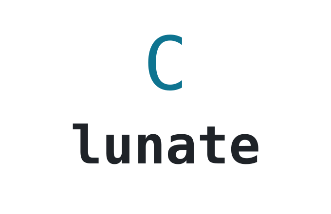
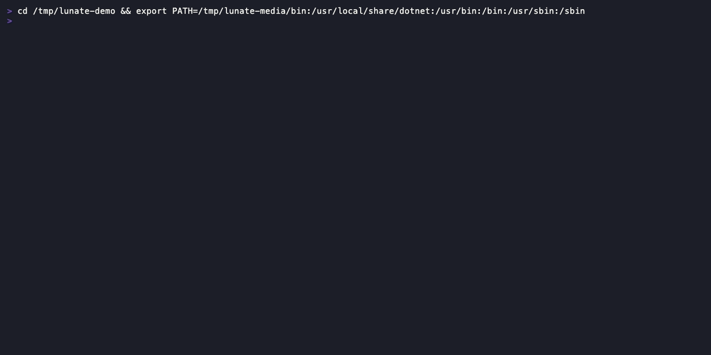
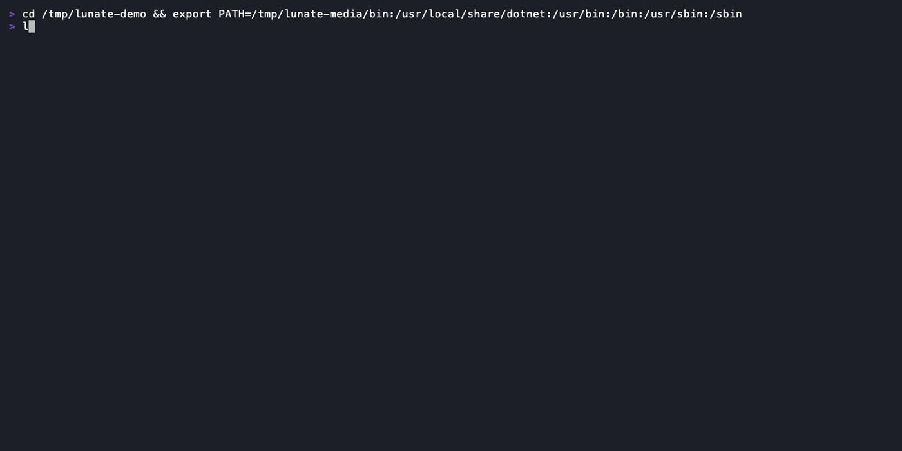
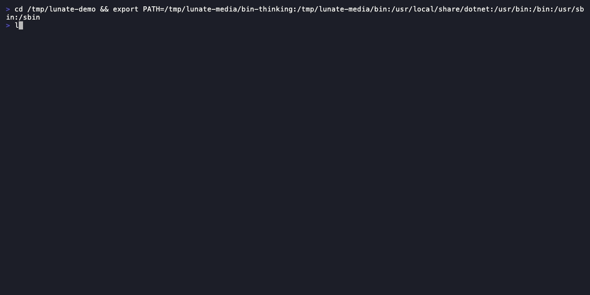

# Lunate

<picture>
  <source media="(prefers-color-scheme: dark)" srcset="docs/media/brand/lunate-logo-dark.png">
  
</picture>

**Small, native, yours: a coding agent you can customise in C#.**

[](https://github.com/wdaniel1993/lunate/actions/workflows/ci.yml)
[](https://github.com/wdaniel1993/lunate/actions/workflows/release.yml)
[](LICENSE)



## Why Lunate

- **Lightweight.** A release is one self-contained binary — no Node, no Python, no .NET runtime to
  install — and `lunate --version` starts in tens of milliseconds. CI holds the startup median to
  250 ms on Ubuntu, 300 ms on macOS and 350 ms on Windows ([ADR-0005](adr/0005-budget-calibration.md)).
- **Made for C#.** Roslyn semantic tools with no plugin and no language server to install:
  `cs_diagnostics`, `cs_find_symbol`, `cs_find_references`, `cs_outline` and `cs_rename`, offered
  only in a C# workspace and loaded on first use. On the published head-to-head C# suite Lunate
  finished 6/6 at **~5× fewer tokens** than the heavy harnesses on the same tasks — 78k against
  378k and 451k — and the write-up is candid about what that suite does and does not show
  ([`docs/eval/t35-head-to-head.md`](docs/eval/t35-head-to-head.md)).
- **Yours, in the language it is written in.** Extensions load at runtime and add tools
  (`context.RegisterTool(...)`), hook handlers, terminal UI renderers and widgets, MCP servers,
  model providers and skills. Start from [`templates/extension/`](templates/extension/README.md);
  the contract is [`docs/spec/extensibility.md`](docs/spec/extensibility.md).
- **Open protocols.** An MCP client for servers you already run, an ACP server so an editor such as
  Zed or JetBrains drives it, Agent Skills (`SKILL.md`) and `AGENTS.md` for project rules.
- **A daily driver.** Every write and command asks first — edits show you their diff — repository
  code asks once per repository before it runs, sessions resume, and print mode (`lunate -p`,
  `--json`) scripts the whole thing for CI.

## Install

No release is tagged yet, so build from source. The package-manager channels — Homebrew, Scoop,
winget, the `curl | sh` and `irm | iex` installers and the `dotnet tool` package — land with the
first release.

Prerequisite: the [.NET 10 SDK](https://dotnet.microsoft.com/download), pinned in
[`global.json`](global.json) at 10.0.401.

```bash
git clone https://github.com/wdaniel1993/lunate
cd lunate
dotnet tool restore                      # CSharpier, pinned as a local tool
dotnet build lunate.sln -c Release
src/Lunate.Coding/bin/Release/net10.0/lunate --version   # lunate.exe on Windows
```

The release archives are self-contained single files; publish one the same way (Windows: `win-x64`,
and the binary is `lunate.exe`):

```bash
dotnet publish src/Lunate.Coding/Lunate.Coding.csproj -c Release -r osx-arm64 \
  --self-contained true -p:PublishSingleFile=true -p:PublishReadyToRun=true \
  -o artifacts/publish/osx-arm64
artifacts/publish/osx-arm64/lunate
```

Contributor setup — the gate, the repository map and the OpenSpec workflow — is in
[`CONTRIBUTING.md`](CONTRIBUTING.md).

## Quick start

**1. Pick a model and a credential.** The built-in catalog carries `gpt-4o-mini`, `gpt-4o`,
`claude-sonnet-5-5` and `claude-opus-5-5`. Put the default in `~/.lunate/settings.json`:

```json
{ "schemaVersion": 1, "model": "claude-sonnet-5-5" }
```

Then give that provider a key — exported, or stored under the provider's name (`openai`,
`anthropic`) in `~/.lunate/auth.json`:

```bash
export ANTHROPIC_API_KEY=sk-ant-...
```

```json
{ "schemaVersion": 1, "keys": { "anthropic": "sk-ant-..." } }
```

An environment variable wins over the file. A model with a declared `endpoint` — a local server or
any OpenAI-compatible API — needs no key at all; `lunate --discover <name-or-url>` drafts a catalog
entry for one.

**2. Run it in a repository.**

```bash
cd ~/my-project
lunate                                            # the interactive session, on a terminal
lunate -p "summarise what changed on this branch" # print mode: the final answer on stdout
lunate -p --json "..."                            # every event as one JSON line
```

Without a terminal the interactive session exits with a hint to print mode instead of starting
half-broken.

**3. Learn three keys.** `/help` lists the commands, `/model` picks a model or switches to one by
id, and `/quit` leaves. The rest of the built-ins: `/new`, `/resume`, `/compact`, `/context`,
`/mcp`, `/extensions`, `/skills`, `/skill:<name>` and `/trust`.

If nothing resolves a model or a key, the first run prints exactly one fix, for example
`set 'model' in ~/.lunate/settings.json` or `add the 'anthropic' key to ~/.lunate/auth.json`.

## Features

### Type, complete, send

The input is a box: rules above and below it at 80 columns or wider, a muted `Ask anything, / for
commands` placeholder while it is empty, and a box that grows with the draft to eight lines before
it scrolls. Typing `/` opens the autocomplete list — the built-in commands, `/skill:<name>` and
each loaded extension's commands, with descriptions — and `@` lists matching workspace files from
the lazy file index. Both lists cap at eight rows above the input; ↑/↓ move the selection (history
when the list is closed), `Tab` or `Enter` accepts, and `Esc` closes the list first.


### Edits you approve, with the diff

Writes and edits stop at one line — `Allow edit src/Order.cs?  [y]es  [n]o  [a]lways this session` —
and the change is printed as a diff before it lands. The result names the match tier it used
(`exact`, `normalized` or `indent`), and an ambiguous edit is refused instead of guessed.


### Tool calls commit as one line

A finished call collapses to one header line — `✓ read  src/Foo.cs (1-13)`,
`✗ bash  dotnet test · exit 1 · 12s`, `✓ edit  src/Foo.cs · +3 −0` (ASCII `+`/`x` without Unicode) —
with a per-tool excerpt and the diff for `edit`/`write` under it. What the excerpt elides is one
`ctrl+o` away: the full-screen transcript viewer shows every block with its complete output and
diff, scrolls with the arrows and PageUp/PageDown, and closes on `q` or `Esc`.


### C# the compiler agrees with

In a C# workspace the model can ask `cs_diagnostics` for compiler errors and warnings — a compile
check after an edit without a full `dotnet build` — and navigate by symbol with `cs_find_symbol`,
`cs_find_references` and `cs_outline`. Roslyn loads on the first C# tool call, and restore, SDK and
partial-load problems come back as messages the model can act on.



### Repository code asks once

A project extension, a project `mcp.json` server and a project skill are code from the repository,
so each asks once per repository — and again when its files change:
`Load project extension 'acme-tools' 0.3.0 from /repo/.lunate/extensions/acme-tools?  [y]es  [n]o`.
Answers are recorded in `~/.lunate/trust.json`; `lunate trust` inspects and records them for
scripted runs.


### You can see what is loaded

`/extensions` lists every discovered extension with its scope, state, load time and what it
registered; `/mcp` lists the MCP servers with their status and source. `lunate extensions --json`
prints the same data for scripts.


### You can watch it think

With a reasoning model, `/thinking low|medium|high` (or `thinking` in `settings.json`) turns
reasoning on: it streams live in the live area in its own colour and collapses to a single
`✦ thought for Ns` line when the model is done. `thinkingFull` commits the full text instead.



## Configuration

Everything of yours lives under `~/.lunate/`, and nothing there is required: without a settings file
you get the defaults below.

### Models and providers

- `~/.lunate/settings.json` — `model` names the default model id.
- `~/.lunate/models.json` — your own catalog entries: `id`, `provider` (`openai` for any
  OpenAI-compatible endpoint, `anthropic`), optional `endpoint`, `contextWindow`, `supportsTools`
  and an `auth` reference naming a key in `auth.json`. An entry overrides a built-in one with the
  same id; `lunate --discover <name-or-url>` drafts one from a live endpoint. An optional
  `reasoning` declares the model's reasoning style — `effort` (OpenAI-compatible reasoning
  effort), `budget` (Anthropic extended thinking) or `inline` (the model embeds thinking
  markers in its text stream); absent means no reasoning support.
- `~/.lunate/auth.json` — named API keys under `keys`; `OPENAI_API_KEY` and `ANTHROPIC_API_KEY`
  override the `openai` and `anthropic` entries.

### Settings

`~/.lunate/settings.json` carries `schemaVersion: 1`. An unknown key or a bad value is one error
naming every problem, and nothing partial is applied.

| Key | Default | What it does |
| --- | --- | --- |
| `schemaVersion` | — | must be `1` |
| `model` | unset | the default model id |
| `approval` | `ask` | `ask`: writes, edits and commands need approval; `auto-edit`: writes and edits run, commands still need approval |
| `output.toolResultLimit` | `30000` | characters of one tool result before it is truncated |
| `subagents.concurrency` | `4` | concurrent child runs in one tree, or `unlimited` |
| `subagents.tokenBudget` | `100000` | tokens per child run, or `unlimited` |
| `subagents.treeTokenBudget` | `500000` | tokens per top-level run tree, or `unlimited` |
| `roslyn.maxLoadedWorkspaces` | `2` | C# workspaces kept loaded across roots |
| `startupHeader` | `true` | print the welcome header when a session starts |
| `thinking` | `off` | reasoning level: `off`, `low`, `medium` or `high` (`/thinking` sets it per session) |
| `thinkingFull` | `false` | commit the full reasoning text instead of the collapsed thought line |

Environment variables override the file: `LUNATE_MODEL`, `LUNATE_APPROVAL`,
`LUNATE_TOOL_OUTPUT_LIMIT`, `LUNATE_STARTUP_HEADER` (`true`, `false`, `1` or `0`),
`LUNATE_SUBAGENTS_CONCURRENCY`, `LUNATE_SUBAGENTS_TOKEN_BUDGET` and
`LUNATE_SUBAGENTS_TREE_TOKEN_BUDGET`. `yolo` is not a setting: it exists only as the per-run flag
`lunate -p --yolo`.

**Recording and replay.** `LUNATE_RECORD=1` records a run's model stream to a session recording
(`LUNATE_RECORD_PATH` names the file), `LUNATE_REPLAY=<file>` runs a session from that recording
instead of calling a provider, and `LUNATE_DATE=yyyy-MM-dd` pins the date the system prompt is built
with so a replayed request stays byte-stable. Recording wins when both are set.

### Project instructions

Every `AGENTS.md` from the repository root down to the directory you started Lunate in is appended
to the system prompt under its relative path — the nearest file adds to the chain rather than
replacing it. There is no Lunate-specific instructions file.

### MCP servers

`mcpServers` maps in the user files `~/.lunate/mcp.json` and `~/.agents/mcp.json`, and in the
project files `.lunate/mcp.json`, `.agents/mcp.json` and `.mcp.json`. An entry carries `command`,
`args`, `env`, optional `cwd` and optional `callTimeoutSeconds`; `${VAR}` and `${VAR:-default}`
expand when the file loads. Within a scope `.lunate/` wins over `.agents/` wins over `.mcp.json`,
and a project file wins over a user file. Servers start on first use, their tools arrive as
`server__tool`, and a project file and each of its servers needs its own trust decision.

### Extensions

A directory with an `extension.json` manifest in `~/.lunate/extensions/` (global) or
`.lunate/extensions/` (project) is discovered at session start and loaded on first use. Per-extension
settings go in `~/.lunate/extensions-settings/<id>.json` and secrets in
`~/.lunate/extensions-secrets/`. `lunate --no-extensions` starts any mode without loading them.

### Skills

A skill is a directory with a `SKILL.md`. Project scope: `.lunate/skills`, `.agents/skills`,
`.claude/skills`; user scope: `~/.lunate/skills`, `~/.agents/skills`. The nearest scope wins.
`/skills` lists them, `/skill:<name>` loads one, and the model gets a capped index of the rest.
Project skills need a trust decision like any other repository code.

## Modes

- **Interactive** — `lunate`: the TUI session with approvals, the live area and command history
  ([`openspec/specs/tui/spec.md`](openspec/specs/tui/spec.md)).
- **Print** — `lunate -p [--json] [--yolo] "<prompt>"`: one prompt to completion, the final answer as
  the only thing on stdout, diagnostics on stderr, exit codes that scripts can branch on
  ([`openspec/specs/print-mode/spec.md`](openspec/specs/print-mode/spec.md)).
- **ACP** — `lunate --acp`: serves the Agent Client Protocol over stdio for an editor, with nothing
  but protocol on stdout ([`openspec/specs/protocols/spec.md`](openspec/specs/protocols/spec.md)).

## Extending

An extension is an assembly plus a manifest. The factory is the whole entry point:

```csharp
public sealed class HelloFactory : IExtensionFactory
{
    public IExtension Create(IExtensionContext context)
    {
        context.RegisterTool(new ExtensionToolRegistration
        {
            Name = "hello", Description = "Greets a name.",
            ParametersSchema = Schema, Handler = new HelloHandler(),
        });
        return new HelloExtension();
    }
}
```

The model calls that tool as `<extension-id>__hello`, it goes through the same approval policy as
the core tools, and hook handlers, UI renderers and widgets, MCP servers, model providers and skill
sources register the same way.

- Get started: [`templates/extension/README.md`](templates/extension/README.md) — manifest, wiring
  and the test kit
- Contract and hook catalogue: [`docs/spec/extensibility.md`](docs/spec/extensibility.md)
- Reference extensions that run in CI: [`samples/extensions/`](samples/extensions/)

## Security model

Lunate is a single-user tool, not a sandbox. The file tools (`read`, `write`, `edit`) resolve paths
canonically — symlinks included — and refuse anything outside the working directory; `bash` is not
boundary-checked, so the approval policy is its guard, and every write, edit and command asks before
it runs unless you chose `auto-edit` or `--yolo`. Repository-provided code asks once per repository
and re-asks when its content changes. In-process extensions are fully trusted, and an out-of-process
extension runs with your user privileges: the process boundary isolates dependencies and crashes,
not permissions. Secrets are stored owner-only on POSIX and never printed. Report a vulnerability
through GitHub's private vulnerability reporting on this repository — never a public issue — and see
[`SECURITY.md`](SECURITY.md) for the full posture.

## Platform support

Three targets, each built and verified in CI on every commit, plus a performance budget per runner
([ADR-0005](adr/0005-budget-calibration.md)):

| Platform | Release target | CI runner |
| --- | --- | --- |
| macOS (Apple Silicon) | `osx-arm64` | `macos-latest` |
| Linux (x86_64) | `linux-x64` | `ubuntu-latest` |
| Windows (x86_64) | `win-x64` | `windows-latest` |

Terminals: Windows Terminal, conhost, VS Code's integrated terminal, Git Bash, macOS Terminal.app,
iTerm2, Ghostty, WezTerm, Kitty, Alacritty, the common Linux terminals, and tmux/screen over SSH are
documented in the [guide's terminal matrix](docs/guide.md); pipes, CI and `TERM=dumb` are print mode.

## Acknowledgements

Lunate stands on two lightweight agents that came first — **Pi** and **Tau** — for the shape of the
loop, the tool set and the idea that an agent's harness should be small enough to read. The
head-to-head suite that calibrates the claims above runs Pi and Tau beside Lunate
([`docs/eval/t35-head-to-head.md`](docs/eval/t35-head-to-head.md)).

## Contributing

Building, the verification gate, the repository map and the OpenSpec workflow are in
[`CONTRIBUTING.md`](CONTRIBUTING.md); [`AGENTS.md`](AGENTS.md) holds the rules coding agents follow
in this repository.

## License

MIT — see [`LICENSE`](LICENSE).
