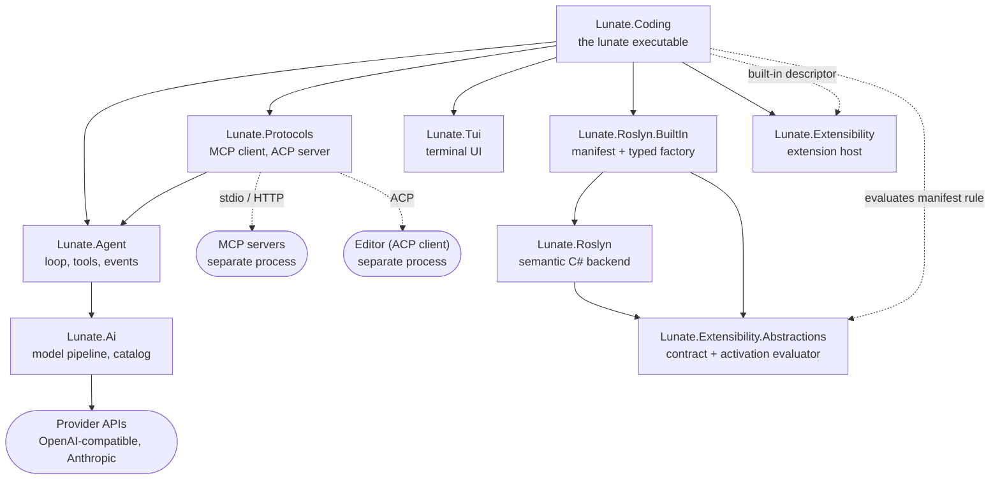
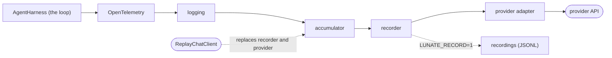
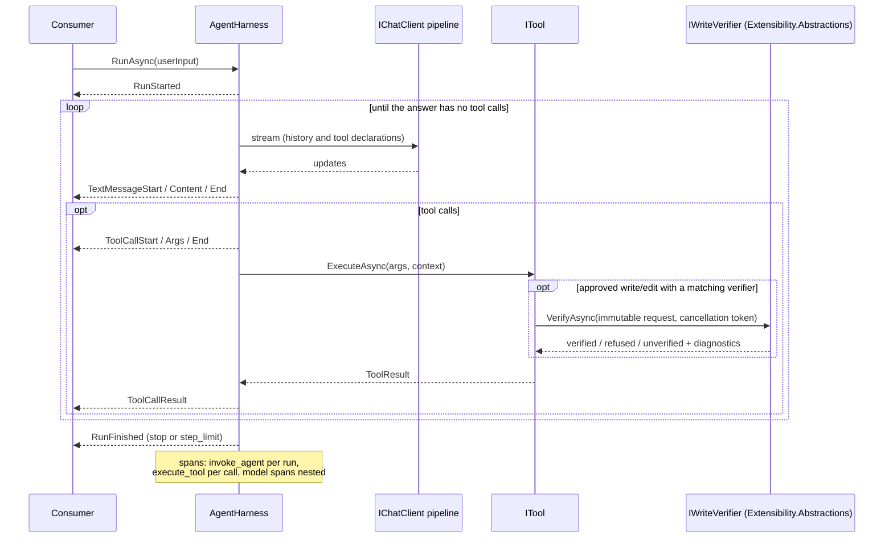
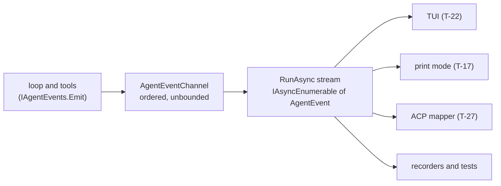

# Architecture

The visual overview of Lunate: what the pieces are, how a run flows, and where each detail lives. Each diagram stays small on purpose — it shows the shape, and links to the spec or ADR that owns the detail. A change that alters a pictured structure updates this page in the same change (see the `repo-quality` spec).

## System map

Solid arrows are project references; dashed arrows are runtime composition or connections to separate processes. `Lunate.Coding` is the composition root. It supplies the Roslyn built-in descriptor to the extension host and runs the shared activation filter, which evaluates the manifest rule through the public abstractions API for chat, print, ACP, child runs and MCP. The adapter owns the typed factory and bridges the extension contract to `Lunate.Roslyn`. `Lunate.Coding` references the adapter only to provide the built-in factory list, and neither Roslyn project references upward into the host. The adapter and backend do not load Roslyn/MSBuild assemblies until the first C# tool call. See [ADR-0026](../adr/0026-roslyn-built-in-boundary.md) and the [extensions spec](../openspec/specs/extensions/spec.md).

## The model pipeline

Order matters: telemetry is outermost (model spans see everything below it), then logging, the accumulator (consumers only ever see complete function calls), the recorder and the provider. Recording is opt-in via `LUNATE_RECORD=1`. Replay is opt-in via `LUNATE_REPLAY=<fixture path>`: the fixture becomes the client with no credential resolved and no provider client constructed (a recording request wins when both are set), so a replayed run still goes through telemetry, logging and the accumulator, like the tests' recorder decorator seam. Homes: [ai-layer spec](../openspec/specs/ai-layer/spec.md), [ADR-0002](../adr/0002-layering-and-meai-model-types.md), [ADR-0010](../adr/0010-anthropic-adapter.md).

## One run

`AgentHarness.RunAsync` is the only entry point; the consumer is the TUI, print mode, the ACP mapper or a test. The loop keeps going until a model answer has no tool calls or `MaxSteps` (default 50) is reached — then `StepLimitReached` and `RunFinished(step_limit)`. One `invoke_agent` span wraps the run; `execute_tool` spans hang off it; model-call spans nest under it. Homes: [agent-loop spec](../openspec/specs/agent-loop/spec.md), [ADR-0003](../adr/0003-loop-own-vs-maf-harness.md), [ADR-0012](../adr/0012-tool-contract.md), [ADR-0013](../adr/0013-agent-loop.md).

For a matched verifier, the `write`/`edit` tool calls it after approval and before applying staged
content; the request cannot replace that content. `verify` defaults to `block`, which prevents a
write on refusal; `warn` writes and reports unverified with diagnostics, while `off` skips the check.
Verification is bounded to 10 seconds; a timeout writes as unverified. Esc cancels the run through
the usual cancellation path and leaves the staged content unwritten. The verifier contract is
`IWriteVerifier` in `Lunate.Extensibility.Abstractions`.

## The event path

Every event of a run — the loop and the tools alike — travels one ordered channel, and `RunAsync` exposes it as a stream. The TUI, print mode and the ACP mapper are consumers (later cards); tests record the same stream. Home: [agent-events spec](../openspec/specs/agent-events/spec.md); the AG-UI and ACP mapping table lives in the [guide](guide.md).
