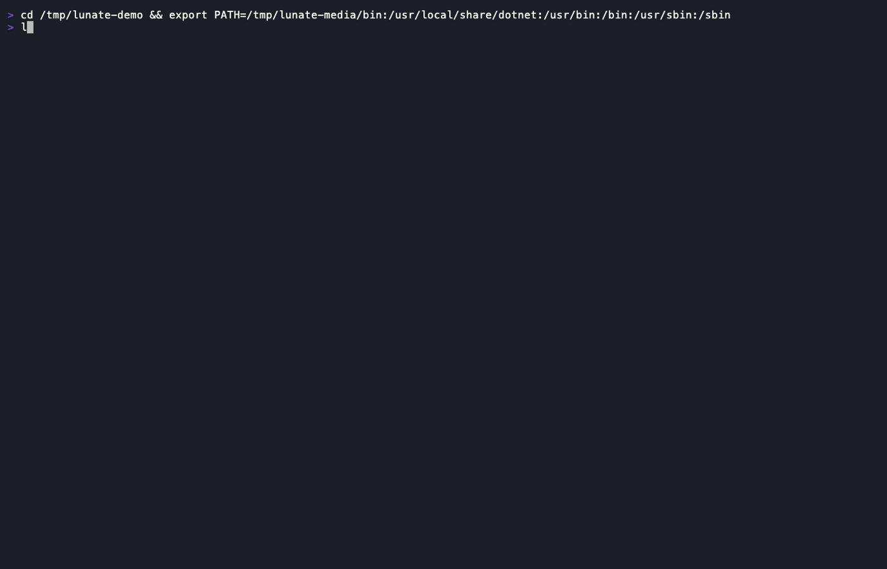
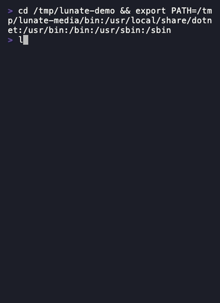
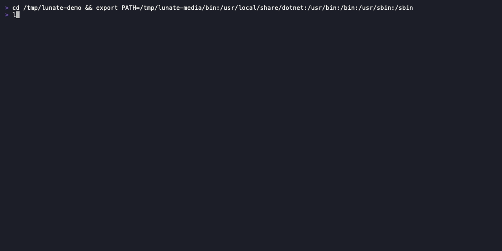
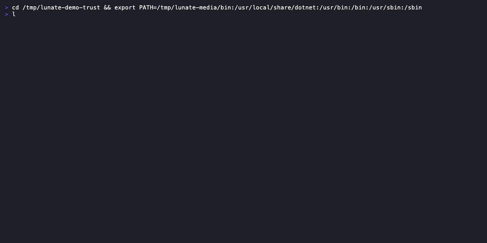
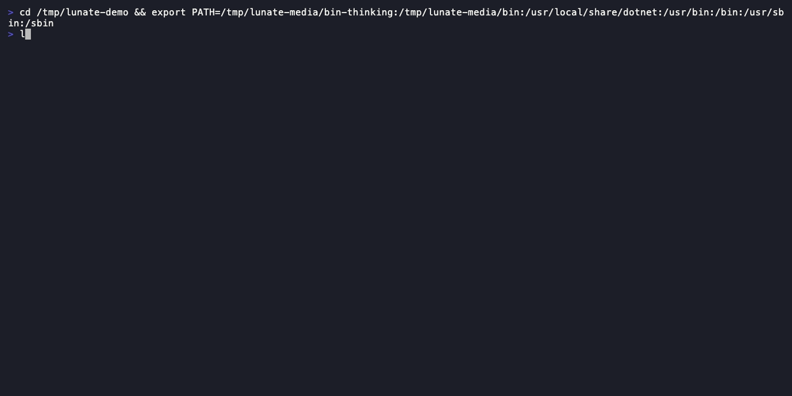

# Usage

What the interactive session does turn by turn: typing and completing a prompt, what a turn commits
to the scrollback, how tools and approvals appear, sessions and exports, thinking and decisions —
and the three modes Lunate runs in. Configuration lives in the [configuration
reference](configuration.md); export and debug contracts in [`spec/export.md`](spec/export.md) and
[`spec/diagnostics.md`](spec/diagnostics.md).

## Type, complete, send

The input is a box: a rule above it at every width, a second rule below from 60 columns, the `>`
marker and the `Ask anything, / for commands` placeholder in the theme's user colour while it is
empty, and a box that grows with the draft to eight lines before it scrolls. Typing `/` opens the
autocomplete list — the built-in commands, `/skill:<name>` and each loaded extension's commands,
with descriptions — and `@` lists matching workspace files from the lazy file index. Both lists
cap at eight rows above the input.

| Key | At the prompt |
| --- | --- |
| `/` | list commands, skills and extension commands |
| `@` | list workspace files |
| `↑` / `↓` | move the autocomplete selection; history when the list is closed |
| `Tab` / `Enter` | accept the selected item; Enter sends when the token is already exact |
| `Esc` | close the list first, otherwise cancel the running turn |
| `Alt+Enter` / `Ctrl+J` | insert a newline |

## Every turn opens with your message

The submitted prompt commits to the scrollback as the first block of its turn — the `>` prompt in
the theme's user colour, wrapped continuation lines indented two spaces, one blank line after — so the
question stays visible above the answer. While the turn runs, the activity line names the work
(`⠹ thinking… 3s`, `⠸ read src/Foo.cs · 4s`, `| working… 7s`), with the run's `↑in ↓out` deltas and
`esc to interrupt` on the wide bands; below 60 columns it keeps the spinner, the label and the
elapsed seconds.

## It fits a narrow terminal

Below 60 columns the layout switches to its compact band: tool headers drop the argument summary
(`✓ read · 13 lines`), the footer shrinks to the model and the context percent, the input box keeps
both rules, and the autocomplete list keeps only the names. The full
layout returns from 100 columns; the guide's
[Narrow terminals](guide.md#terminal-ui-lunatetui) section has the per-band rules.

## Edits you approve, with the diff

Writes and commands stop at a panel: a warning headline naming the tool and what it will do, a
bounded detail block with the command or the edit's diff, and
`Allow edit?  [y]es  [n]o  [a]lways this session`. Below 60 columns the detail shortens first and
every choice stays on screen. The result names the match tier it used (`exact`, `normalized` or
`indent`), and an ambiguous edit is refused instead of guessed.

## Tool calls commit as one line

A finished call collapses to one header line — `✓ read  src/Foo.cs (1-13)`,
`✗ bash  dotnet test · exit 1 · 12s`, `✓ edit  src/Foo.cs · +3 −0` (ASCII `+`/`x` without Unicode) —
with a per-tool excerpt and the diff for `edit`/`write` under it. What the excerpt elides is one
`ctrl+o` away: the full-screen transcript viewer shows every block with its complete output and
diff, scrolls with the arrows and PageUp/PageDown, and closes on `q` or `Esc`.

## C# the compiler agrees with

In a C# workspace the model can ask `cs_diagnostics` for compiler errors and warnings — a compile
check after an edit without a full `dotnet build` — and navigate by symbol with `cs_find_symbol`,
`cs_find_references` and `cs_outline`. Roslyn loads on the first C# tool call, and restore, SDK and
partial-load problems come back as messages the model can act on.

## Repository code asks once

A project extension, a project `mcp.json` server and a project skill are code from the repository,
so each asks once per repository — and again when its files change:
`Load project extension 'acme-tools' 0.3.0 from /repo/.lunate/extensions/acme-tools?  [y]es  [n]o`.
Answers are recorded in `~/.lunate/trust.json`; `lunate trust` inspects and records them for
scripted runs.

## You can see what is loaded

`/extensions` lists every discovered extension with its scope, state, load time and what it
registered; `/mcp` lists the MCP servers with their status and source. `lunate extensions --json`
prints the same data for scripts.

## You can watch it think

With a reasoning model, `/thinking low|medium|high` (or `thinking` in `settings.json`) turns
reasoning on: it streams live in the live area in its own colour and collapses to a single
`✦ thought for Ns` line when the model is done. `thinkingFull` commits the full text instead.

## Take the answer with you

`/copy` (or `Ctrl+X`) puts the last answer on the clipboard without selecting a wrapped line by
hand, and it works where the session runs: over ssh it writes the OSC 52 sequence — a local
`pbcopy` there would fill a clipboard you cannot see — and locally it runs the platform tool first,
falling back to the same sequence. The notice says only what happened:
`copied 1,842 characters via pbcopy` when a tool proved the write,
`sent 1,842 characters to the terminal clipboard (OSC 52)` when it did not, with tmux's
`set-clipboard on` requirement and the terminal's 100 KB payload limit named in the same line.

`/export html` writes one self-contained document — inline CSS, no JavaScript, a
`default-src 'none'` CSP, thinking collapsed in `
` — that is safe to open even when a tool
result carried hostile markup. `/export jsonl` writes the session file byte for byte. Both default
to `~/.lunate/exports/<date>-<name>.<ext>` (never the current directory, where an export would be
committed), refuse an existing file without `--force`, redact every credential Lunate knows as
`[redacted:<name>]`, and print the absolute path plus a reminder that the file may contain file
contents and command output. [`spec/export.md`](spec/export.md) owns the full contract.

## A second model can decide when it is worth it

`decisions` in `settings.json` names one profile and opts into any of four consumers: approvals
(`off`, `shadow`, `enforce`, with a threshold for how sure a deny must be), routing (`off`, `shadow`,
`enforce` over two or more profiles), the information-only decide tool, and display-only suggestions
beside a question's top option. A decision can only tighten an approval, never grant one; without a
profile the layer stays off. The same gate runs in the TUI, print mode and ACP, and the
[configuration reference](configuration.md) lists every key.

## Fork a session without losing the tail

`/fork` writes a new session file that continues the current one under a new id; `/clone` starts a
copy from an earlier turn. A fork carries the session's images and redacts what the source redacted,
so it resumes instead of failing on the first request.

## Long sessions keep their place

When a tool result would flood the window, the text is spilled to a file and the model sees a short
stub it can page back through; observation masking trims old turns without losing the transcript.
`/context` reports what each saved: `saved tokens: spills 0, masking 0, read stubs 0`.

## Modes

- **Interactive** — `lunate`: the TUI session with approvals, the live area and command history
  ([`openspec/specs/tui/spec.md`](../openspec/specs/tui/spec.md)).
- **Print** — `lunate -p [--json] [--yolo] "<prompt>"`: one prompt to completion, the final answer as
  the only thing on stdout, diagnostics on stderr, exit codes that scripts can branch on
  ([`openspec/specs/print-mode/spec.md`](../openspec/specs/print-mode/spec.md)).
- **ACP** — `lunate --acp`: serves the Agent Client Protocol over stdio for an editor, with nothing
  but protocol on stdout ([`openspec/specs/protocols/spec.md`](../openspec/specs/protocols/spec.md)).

## Project instructions

Every `AGENTS.md` from the repository root down to the directory you started Lunate in is appended
to the system prompt under its relative path — the nearest file adds to the chain rather than
replacing it. There is no Lunate-specific instructions file.

## MCP servers

`mcpServers` maps in the user files `~/.lunate/mcp.json` and `~/.agents/mcp.json`, and in the
project files `.lunate/mcp.json`, `.agents/mcp.json` and `.mcp.json`. An entry carries `command`,
`args`, `env`, optional `cwd` and optional `callTimeoutSeconds`; `${VAR}` and `${VAR:-default}`
expand when the file loads. Within a scope `.lunate/` wins over `.agents/` wins over `.mcp.json`,
and a project file wins over a user file. Servers start on first use, their tools arrive as
`server__tool`, and a project file and each of its servers needs its own trust decision.

A stdio server is a child process and inherits Lunate's environment, so existing MCP setups keep
working — with one exception: the credentials Lunate itself knows are withheld from that child.
The provider keys the model presets and the provider store reference, the keys in `auth.json`,
the extension secrets and the `env` values the configured entries set are removed from the child's
environment (the variables are gone, not emptied), unless the server's own `env` map names the
variable explicitly; `${VAR}` in a declared value still resolves from Lunate's environment.

Lunate can also be the server: `lunate mcp roslyn` serves the five read-only `cs_*` C# tools over
stdio to another MCP host, with no approvals or write path behind them.
[`mcp-roslyn.md`](mcp-roslyn.md) covers the configuration and what it leaves out by design.

## Skills

A skill is a directory with a `SKILL.md`. Project scope: `.lunate/skills`, `.agents/skills`,
`.claude/skills`; user scope: `~/.lunate/skills`, `~/.agents/skills`. The nearest scope wins.
`/skills` lists them, `/skill:<name>` loads one, and the model gets an index of the rest — one
line per skill, its description carried whole to the Agent Skills limit of 1,024 characters
(a longer description makes the skill invalid with a warning), sized by the model's context
window: a one-time notice above the 2% soft threshold, a cut-from-the-end overflow above the 5%
hard ceiling. `skills.indexBudget` overrides both.
Project skills need a trust decision like any other repository code.

## Related

- [First run](first-run.md) — choosing a provider, `lunate auth`, the setup wizard
- [Configuration reference](configuration.md) — every settings key, generated from the schema
- [Export contract](spec/export.md) — what `/copy` and `/export` guarantee
- [The Roslyn MCP server](mcp-roslyn.md) — the C# tools from another MCP host
- [Security policy](../SECURITY.md) — the full trust model and how to report
