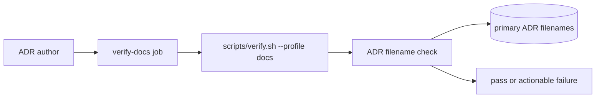

## Context

The docs profile is `scripts/verify.sh --profile docs`; CI runs it from the `verify-docs` job. It already needs Python for `scripts/docs-sync`, runs no build or tests, and is the right home for a filename-only check. `docs/README.md` links authors to `adr/`, but there is no ADR README; `docs/guide.md` is the author-facing source.

The current ADR inventory has primary numbers 0001–0027, with two primary files claiming 0027. Numbered `NNNN-addendum-*.md` records also reuse their parent numbers by convention. The check must distinguish those intentional addenda without overlooking duplicate primary ADRs. The two accepted 0027 records are immutable project records; choosing how to resolve that collision belongs to a maintainer before the follow-up implementation can pass the live-tree gate.

## Goals / Non-Goals

**Goals:**

- Check primary ADR filename prefixes for duplicates and gaps in the existing docs profile.
- Keep the check build-free and dependency-free, and provide the three required fixture cases.
- Give authors diagnostics with paths, missing numbers where applicable, and the next free number.
- Document the numbering convention in `docs/guide.md`.

**Non-Goals:**

- Implement the checker or add fixtures in this proposal-only change.
- Rewrite accepted ADR content or choose a canonical 0027 record.
- Parse ADR bodies, titles, Git history, or references outside `adr/`.
- Add a new package or change CI profile selection.

## Decisions

### Check filename prefixes in the existing docs profile

Use the standard library and the existing Python prerequisite; integrate the live-tree check into `scripts/verify.sh --profile docs`, which CI already invokes from `verify-docs`. Do not add a build, test suite, package, or separate CI job. This keeps the check in the gate that already owns prose-only changes.

Alternatives considered: a separate workflow would duplicate profile selection and risk bypassing the existing required check; parsing ADR contents would violate the filename-only requirement and make title punctuation relevant.

### Treat addenda as continuations, not primary number claims

Primary ADR files are numbered `NNNN-<slug>.md`; `NNNN-addendum-<slug>.md` is an explicit continuation of its parent and does not claim a new sequence number. Exclude only that exact addendum filename form. This follows the repository's existing names and preserves the intent that each primary decision has one sequence number.

Alternatives considered: count every numeric prefix, which would reject the established addendum convention; or allow arbitrary duplicate prefixes, which would hide the primary ADR collision the check is intended to catch.

### Define density and diagnostics from the primary sequence

Require primary numbers to be unique and form the sequence `0001` through the highest assigned number. A duplicate diagnostic names both repo-relative paths and reports `highest + 1` as the next free number. A gap diagnostic names the files bracketing the gap, lists the missing number(s), and also reports `highest + 1`. Render reported paths with `/` separators so fixture expectations do not depend on the host platform. The clean fixture is a consecutive set starting at `0001`.

Alternatives considered: infer the next number from document titles or scan all Markdown text; both are fragile because accepted ADR titles and filenames are not guaranteed to contain the same punctuation or wording.

### Keep the existing 0027 collision explicit

The real tree currently has two accepted primary 0027 files. The check must report this rather than silently exempt either file. The follow-up implementation cannot make the live docs profile green until a maintainer decides how to preserve the immutable records while correcting the collision; this proposal does not guess which accepted record to rename, consolidate, or supersede.

Alternatives considered: ignore the known collision (would make the check incomplete) or rewrite accepted records in this proposal (outside scope and contrary to the repository's record-history rule).

### Flow of the check (lightweight C4-inspired)

Assumption: `verify-docs` continues to run the repository's docs profile; this change does not alter CI selection or add a new runtime boundary.

## Risks / Trade-offs

- **[Existing duplicate prevents a green live-tree check]** -> The checker must expose the collision; record the maintainer-required resolution in #339 before implementing the gate step.
- **[Addendum naming drifts]** -> Match only the explicit `NNNN-addendum-` marker and document that convention for new authors.
- **[Diagnostic tests become host-specific]** -> Use repo-relative paths with normalized `/` separators and build expected paths from the same fixture root.

## Migration Plan

No migration occurs in this proposal. In #339, first obtain maintainer direction for the existing accepted 0027 collision, then implement the filename check and three fixtures, add the rule to `docs/guide.md`, and run the docs profile. Rollback is removal of the profile invocation and checker if the diagnostic contract proves unsuitable; no runtime data is affected.

## Open Questions

- Maintainer resolution of the existing duplicate accepted 0027 records is required before the live-tree check can pass. The proposal does not select a canonical record or rewrite ADR history.
