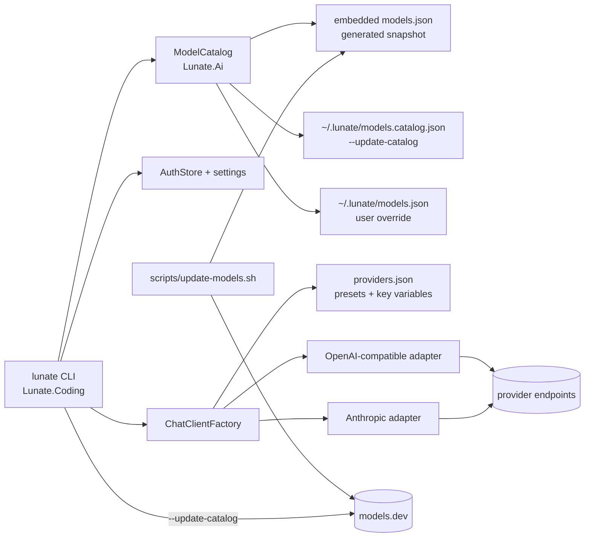

# Design — provider-presets

## Context

Lunate's model access is two hard-coded providers and a four-entry catalog. The current shape is
small and deliberate, but it pushes every other provider into hand-written user data.

**Recon anchors (observed in the tree, not assumed):**

1. **Catalog and model type.** `ModelInfo` is a public positional record with `Id`, `Provider`,
   `Endpoint`, `ContextWindow`, `SupportsTools`, `AuthRef`, `Reasoning`
   (`src/Lunate.Ai/ModelInfo.cs:9-17`). `ModelCatalog` accepts only `schemaVersion` 1
   (`src/Lunate.Ai/ModelCatalog.cs:11,66-80`), embeds `models.json`
   (`src/Lunate.Ai/Lunate.Ai.csproj:32`), loads `~/.lunate/models.json` unless a path is injected
   (`src/Lunate.Ai/ModelCatalog.cs:24-35`), and merges user entries over built-ins by id while
   keeping the built-in position (`src/Lunate.Ai/ModelCatalog.cs:124-139`). The four starter entries
   are `gpt-4o-mini`, `gpt-4o`, `claude-sonnet-5-5`, `claude-opus-5-5`
   (`src/Lunate.Ai/models.json:2-8`).
2. **Provider and credential resolution.** `ChatClientFactory` recognises only `openai` and
   `anthropic` (`src/Lunate.Ai/ChatClientFactory.cs:118-135`); `CreateOpenAiClient` sets the
   endpoint only when the entry declares one (`:143-157`); the Anthropic adapter uses the SDK default
   when `Endpoint` is null (`:160-179`). `ResolveApiKey` gives an `AuthRef` first, then the
   placeholder for any declared endpoint, then the provider environment variable, then the auth
   store under the provider name (`:188-233`). The variable table is two entries
   (`:231-232`). `ReasoningParameters` maps the existing `Reasoning` style (`effort`, `budget`,
   `inline`) rather than a boolean (`src/Lunate.Ai/ReasoningParameters.cs:38-45`).
3. **Settings, auth and CLI.** `AgentSettings` has `Model` but no favourites
   (`src/Lunate.Coding/SettingsStore.cs:19-44`); settings are read-only and pinned to schema 1
   (`:61-71`, parse at `:139-201`, environment override at `:465-475`). `AuthStore` reads
   `auth.json`, exposes `TryGet`/`Set`/`Save` (`src/Lunate.Coding/AuthStore.cs:47-117`), and maps
   only two provider names to environment variables (`:201-207`). `Cli` dispatches modes before
   launch parsing (`src/Lunate.Coding/Cli.cs:33-138`) and `--discover` is a standalone branch
   (`:67-76`, `:265-291`). `DiscoverCommand` knows only the two native default endpoints
   (`src/Lunate.Coding/DiscoverCommand.cs:260-273`) and emits a schema-1 draft (`:214-218`).
4. **Model resolution and commands.** The interactive session resolves the model after extension
   composition (`src/Lunate.Coding/InteractiveSession.cs:363-445,452-496`), and `BuildHarness`
   rebuilds on a switch (`:706`). `/model` switches or opens the picker
   (`src/Lunate.Coding/InteractiveSession.Commands.cs:83-98,461-530`). `/session` currently sums only
   input/output tokens and explicitly prints no cost (`:241-277`). `Commands` is the one built-in
   command table (`src/Lunate.Coding/Commands.cs:37-62`), and `CompletionRegistry` composes from it
   (`src/Lunate.Coding/CompletionRegistry.cs:42-59`).
5. **TUI footer and keys.** Footer data is `StatusFooterModel`
   (`src/Lunate.Tui/Interaction/StatusFooter.cs:9-19`), rendered as model, usage, thinking,
   directory, branch, then widgets (`src/Lunate.Tui/Interaction/StatusFooterRenderer.cs:27-102`).
   The wiring copies the coding status into it (`src/Lunate.Coding/TuiUserInteraction.cs:19-32`).
   `KeyRouter` binds Ctrl+L to the model picker, Ctrl+O to the transcript and has no Ctrl+P
   (`src/Lunate.Tui/Interaction/KeyRouter.cs:25-40`).
6. **Usage lanes.** `UsageUpdated` already carries `UsageDetails` and an optional resolved
   `ModelId` (`src/Lunate.Agent/AgentEvent.cs:85-91`). The interactive session accumulates input,
   output, cache read (`CachedInputTokenCount`) and cache write
   (`AdditionalCounts["CacheCreationInputTokens"]`) (`src/Lunate.Coding/InteractiveSession.Events.cs:316-342`).
   The session records only `SessionUsage(Input, Output)` (`src/Lunate.Agent/SessionEntry.cs:115`),
   built at `src/Lunate.Agent/AgentHarness.cs:589-604` and serialized as `input`/`output`
   (`src/Lunate.Agent/SessionFormat.Serialize.cs:113-120`).
7. **Replay records the model.** A message entry carries the model id per turn
   (`src/Lunate.Agent/SessionEntry.cs:20-28`) and the serializer writes it when present
   (`src/Lunate.Agent/SessionFormat.Serialize.cs:108-111`). A replay can therefore attribute each
   usage record to a model; it cannot yet split cache lanes because they were never persisted.
8. **Tests that pin the old shape.** `ModelCatalogTests.Load_without_user_file_returns_embedded_starter_models`
   (`tests/Lunate.Ai.Tests/ModelCatalogTests.cs:6-49`) asserts the four entries and schema-1 user
   files throughout; `SettingsStoreTests` and `SettingsStoreThinkingTests` assert schema-1 parsing;
   `AuthStoreTests` pins the two-provider override; `PrintModeTests` pins model precedence
   (`:623-669`) and the unknown-model error (`:743-760`); `CliTests` pins the help line and
   `--discover` usage (`:147,456-481`); `InteractiveSessionCommandTests` pins `/help`, the picker
   labels and `/session` without a cost (`:61-101,500-541`); the TUI goldens pin the footer
   (`tests/Lunate.Tui.Tests/PromptFooterGoldenTests.cs`, `StatusFooterRendererTests.cs`) and
   `KeyRouterTests` pins the binding matrix. Session goldens under `tests/fixtures/sessions/` are
   schema 1 and 2 and must keep their bytes.

**Composition today and after this change (containers/components, not deployment):**

The catalog is the only source of model metadata; presets are the only source of provider base URLs
and key variables; auth is still the only place a secret is stored.

## Goals / Non-Goals

**Goals:**

- One generated catalog covering the preset providers, refreshed explicitly and never at startup.
- A preset is enough to use a provider: base URL, key variable and qualified ids come from data.
- `/login` makes the stored-key path usable without hand-editing JSON or leaking a secret.
- A turn's and a session's cost are visible and correct when the catalog can price every lane.
- Favourites make the common model switch one key press.
- Schema 1 settings, catalogs and sessions keep working; no golden is edited to hide a change.

**Non-Goals:**

- Subscription OAuth, embeddings, audio, image generation, a hosted catalog service or a background
  refresh loop.
- Per-request tier pricing (`cost.tiers`, `context_over_200k`); the base rate is the catalog rate.
- A new provider SDK: every preset except Anthropic uses the existing OpenAI-compatible adapter.
- Changing the tool loop, event contract or extension model surface.

## Decisions

### D1 — Catalog: a generated models.dev snapshot, schema 2

**Intent.** `src/Lunate.Ai/models.json` is a committed, deterministic snapshot of models.dev for
the preset providers. A repo script regenerates it; the app never downloads a catalog implicitly.

**Data.** Add a second embedded file `src/Lunate.Ai/providers.json` (schema 1): one entry per preset
with `id`, display name, adapter kind (`anthropic` or `openai-compatible`), base URL and key
variable. The script, the runtime preset registry and the docs table all read this one file.

**Mapping (models.dev → catalog):**

| models.dev | Catalog (schema 2) |
| --- | --- |
| provider key + model key | non-native `id` = `<provider>/<model>`, `provider` = provider key, `wireId` = model key; native `id` = model key, no `wireId` |
| `limit.context` | `contextWindow` |
| `limit.output` | `maxOutput` |
| `tool_call` | `supportsTools` |
| `attachment` | `supportsVision` |
| `cost.input/output/cache_read/cache_write` | `pricing.input/output/cacheRead/cacheWrite`, decimals preserved |
| `reasoning: true` | `reasoning` = `budget` for Anthropic, `effort` for OpenAI-compatible; false/absent = omitted |
| `name` | ignored (display id is the catalog id) |

`endpoint` is omitted for generated entries: a preset supplies the base URL, and an entry that
declares an endpoint continues to count as user-declared (the safe-credential rule). Ordering is
preset-config order, then model id ordinal, so regeneration is byte-stable. The file carries
`source: { name: "models.dev", url, sha256 }`; there is no generation timestamp. A top-level
`source` object is ignored by the parser. Duplicate ids and duplicate wire ids fail generation.

**Loading and merge.** `ModelCatalog.Load` merges embedded → `~/.lunate/models.catalog.json`
(managed, optional) → `~/.lunate/models.json` (user), last writer wins by id. The managed path is
only read when no explicit user path is injected, so tests and embedded consumers stay hermetic.
Schema 1 files are accepted read-side: a v1 entry gets `Pricing = null`, `MaxOutput = null`,
`SupportsVision = false`, `WireId = null`. Schema 2 is what the generator writes. A malformed or
unsupported file fails naming the path and version, as today.

**One mapper.** The mapping lives in `ModelsDevCatalog` in `Lunate.Ai`. The repo script
`scripts/update-models.sh` (header: `version 1.0.0`; config: the embedded `providers.json`) builds the
CLI and runs `lunate --update-catalog --output src/Lunate.Ai/models.json`. The same command without
`--output` writes the managed cache. There is no second jq mapping to drift.

**Why not jq/curl in the script:** a second mapping would be a second source of truth for ids,
prices and capabilities. The C# mapper is the only implementation; the script is a thin wrapper.

### D2 — Provider presets and routing

**Presets.** `providers.json` carries:

| id | base URL | key variable | adapter |
| --- | --- | --- | --- |
| `openai` | `https://api.openai.com/v1` | `OPENAI_API_KEY` | OpenAI (native default) |
| `anthropic` | `https://api.anthropic.com/v1` | `ANTHROPIC_API_KEY` | Anthropic (native default) |
| `openrouter` | `https://openrouter.ai/api/v1` | `OPENROUTER_API_KEY` | OpenAI-compatible |
| `deepseek` | `https://api.deepseek.com` | `DEEPSEEK_API_KEY` | OpenAI-compatible |
| `moonshotai` | `https://api.moonshot.ai/v1` | `MOONSHOT_API_KEY` | OpenAI-compatible |
| `zai` | `https://api.z.ai/api/paas/v4` | `ZHIPU_API_KEY` | OpenAI-compatible |
| `opencode` | `https://opencode.ai/inference/openai/v1` | `OPENCODE_API_KEY` | OpenAI-compatible |
| `opencode-go` | `https://opencode.ai/inference/go/openai/v1` | `OPENCODE_API_KEY` | OpenAI-compatible |
| `groq` | `https://api.groq.com/openai/v1` | `GROQ_API_KEY` | OpenAI-compatible |
| `togetherai` | `https://api.together.xyz/v1` | `TOGETHER_API_KEY` | OpenAI-compatible |
| `xai` | `https://api.x.ai/v1` | `XAI_API_KEY` | OpenAI-compatible |
| `google` | `https://generativelanguage.googleapis.com/v1beta/openai` | `GOOGLE_API_KEY` (`GEMINI_API_KEY` alias) | OpenAI-compatible |

**Routing.** `ChatClientFactory` asks `ProviderPresets.Find(model.Provider)`. An Anthropic preset
uses the Anthropic adapter exactly as today. Every OpenAI-compatible preset uses the existing
OpenAI adapter with `options.Endpoint = model.Endpoint ?? preset.BaseUrl`, and sends
`model.WireId ?? model.Id` to `GetChatClient`. A model with an explicit endpoint still wins over the
preset URL. A user entry with provider `openai` and no endpoint keeps the OpenAI default. An unknown
provider fails with an actionable error listing the preset ids.

**Credential safety.** A preset base URL is the provider's own endpoint, so the preset's environment
variable may reach it. A model that declares its own `endpoint` is still user-declared and gets the
placeholder credential unless it has an `auth` reference. This preserves the current opt-in rule.

### D3 — Model ids: native bare, everything else qualified

- The four current ids stay bare: `gpt-4o-mini`, `gpt-4o`, `claude-sonnet-5-5`,
  `claude-opus-5-5`.
- Other native (OpenAI/Anthropic) ids are bare too; there is no cross-native collision in the
  snapshot, and a bare id remains the shortest form.
- Every non-native id is `<provider>/<model>`; the upstream id is `wireId`, because OpenRouter model
  ids themselves contain slashes (`openrouter/anthropic/claude-sonnet-5-5`).
- The catalog lookup is exact on `Id`. The wire call uses `WireId ?? Id`, never a parsed id, so a
  slash in a model id is never ambiguous.
- `--discover` on a preset target prints qualified ids and a `wireId`; on a direct URL it keeps the
  existing `openai` provider draft, because a URL has no preset identity.
- A user entry overrides by exact id. A duplicate id inside one file still fails; a bare id that a
  user wants to shadow per provider must be qualified (and is only usable if that provider is a
  preset or the entry declares its own endpoint).

**Migration.** The four ids are untouched, so existing settings keep working. A user file that
already uses a non-native bare id keeps working as a bare user entry; it does not become qualified
silently. The new snapshot never takes an id away.

### D4 — `/login` and `/logout` on the AuthStore

- `/login <provider>` accepts only a known preset id. It opens a masked prompt in the live area; the
  typed key is never echoed, never written to input history, never committed to scrollback, never
  recorded in the session and never logged. Enter saves, Esc or an empty value cancels.
- `AuthStore.Set(provider, key)` then `Save()` keeps the file owner-only on POSIX. No network call
  validates the key; the next model call reports an invalid key.
- `/logout <provider>` removes the stored key with a new `AuthStore.Remove` and saves. It never
  prints a secret; if the provider environment variable is still set it says so by name.
- Credential precedence is unchanged in spirit: an `auth` reference wins for its model; a
  user-declared endpoint uses the placeholder; otherwise the preset's environment variable (or the
  native one, or the Google alias) wins over the auth-store entry under the provider name.
- `AuthStore` and `ProviderKeyProbe` read the same preset table, so the first-run fix names the
  right variable for every preset.

### D5 — No subscription OAuth

Lunate does not add subscription OAuth (Claude Pro/Max, ChatGPT) because those plans authorize
first-party clients and third-party agent use is outside the providers' terms, so API keys and the
provider's own OpenAI-compatible endpoint remain the supported path.

### D6 — Pricing, cost math and where cost appears

- `ModelPricing` is a public record of optional `decimal` rates per million tokens: `Input`,
  `Output`, `CacheRead`, `CacheWrite`. A model without a `cost` object has `Pricing = null`.
- Cost for one usage record:
  `uncached = max(0, input - cacheRead - cacheWrite)`;
  `cost = (uncached×input + cacheRead×cacheRead + cacheWrite×cacheWrite + output×output) / 1_000_000`.
  A lane with a positive count needs its rate; if a needed rate is missing, the record is not fully
  priced and no cost is shown. A missing rate for a lane with zero tokens does not block.
- **Footer**: the current turn's cost is the sum of every `UsageUpdated` in the turn tree (root and
  subagents), looked up by the event's resolved `ModelId` (fallback: the session model). If any
  record in the turn is unpriced, the cost segment is absent for that turn; the token segment is
  unchanged. Formatting is invariant: `$` followed by four decimals below `$1`, two at or above,
  and `<$0.0001` for a positive cost that would round to zero.
- **`/session`**: aggregate recorded messages by model (the "lane" a person switched to) and by
  token lane (input, output, cache read, cache write). Print a total only when every recorded model
  is known, priced where it is used, and every needed lane has a rate. Otherwise print tokens only,
  never `$0`. The split shows model lines and the input/output/cache-read/cache-write parts.
- **`--json`**: `usage_updated` adds a numeric `costUsd` under the same fully-priced predicate;
  absent otherwise. Existing fields keep their shape.
- Prices are display-only catalog data. They are never used for budget decisions, approvals or
  routing.

**Session persistence.** To cost a replay exactly, `SessionUsage` gains optional `CacheRead` and
`CacheWrite` counts, written only when positive. New sessions write schema 3; the loader accepts 1,
2 and 3. Existing v1/v2 goldens must deserialize and re-serialize byte-identically; a new v3 golden
pins the two extra fields. This is a deliberate format event, recorded in ADR-0022, not a silent
golden edit. A v1/v2 session is costed only when its model has no cache rate; otherwise its input
count hides an unknown cache split, so `/session` stays token-only.

### D7 — Favourites: ordered settings, Ctrl+P, footer position

- `settings.json` gains `favorites`: an ordered array of model ids, at most eight, duplicates
  rejected. Settings schema becomes 2; the loader accepts 1 and 2, and a v1 file simply has no
  favourites. Other keys keep their meaning and defaults.
- The settings writer is read-modify-write over the existing JSON: it preserves unrelated keys,
  validates through the same parser, and replaces the file atomically. A write failure leaves the
  old file and reports a notice.
- `/favorite [id]` adds the active model (or the named catalog model) at the end; a duplicate is a
  no-op notice; a ninth entry is refused with `favorites are limited to 8`.
- `/unfavorite [id]` removes the active/named model; removing a model that is not a favourite is a
  no-op notice.
- `Ctrl+P` cycles in list order: from the current model to the next favourite, wrapping; when the
  active model is not a favourite, to the first. An empty list is a notice, never a run. The switch
  uses the existing `SwitchToModel` path (session model-change entry, harness rebuild, footer).
- The footer shows `fav:<position>/<count>` after the usage segment and before the cost segment
  (for example `fav:2/5`) when the active model is in the list; the compact band keeps only model
  and percent, as today.
- Favourites are settings, not session state: a resumed session uses the current settings list.

## Implementation order

1. **Catalog data and types** (Ai): provider config, schema-2 model fields, mapper, generated file,
   merge/schema-1 acceptance, pricing helper. Tests first in `Lunate.Ai.Tests`.
2. **Presets and routing** (Ai): preset registry, factory routing, wire id, key variable resolution,
   `ProviderKeyProbe`/`DiscoverCommand` consumers. Tests in `Lunate.Ai.Tests` and `Lunate.Coding.Tests`.
3. **Settings and auth storage** (Coding): schema 2 + favourites parsing, read-modify-write writer,
   `AuthStore.Remove` and preset env mapping. Tests in `SettingsStoreTests`, `AuthStoreTests`.
4. **CLI surface** (Coding): `--update-catalog` (managed cache and `--output`), help text, login/logout
   command dispatch behind a secret-input seam. Tests in `CliTests`, `InteractiveSessionCommandTests`.
5. **Session usage lanes and costing** (Agent + Coding): schema 3, cache counts, cost aggregation,
   `/session` report, print JSON `costUsd`. Goldens and tests.
6. **TUI, final group** (Tui): footer cost/favourite segments, Ctrl+P routing, masked secret prompt,
   picker/footer goldens, narrow widths.
7. **Docs, ADR-0022 and the gate**: README, guide, script documentation, `openspec validate
   provider-presets --strict`, `scripts/verify.sh`.

## Risks / Trade-offs

- **Catalog size (~750 entries, ~200 KB).** Parsing every entry at startup adds work to a budgeted
  path, and the model picker becomes a long list. → Keep the file compact (no names/descriptions),
  measure startup in `scripts/perf.sh`, keep the managed/user files optional, and treat favourites
  as the fast path through the picker. If the budget fails, prune providers or switch the catalog
  to a line-oriented format in a follow-up.
- **Id migration.** Bare native ids, qualified non-native ids and old user files coexist. → Never
  parse ids to find the wire id (`wireId` only), keep the four ids byte-identical, test lookup of all
  four, a qualified id and a user override, and document that a shadowed bare id must be qualified.
- **Price drift.** models.dev prices change, can be missing, and carry context tiers the flat model
  ignores. → Pin the source hash in the snapshot, regenerate before releases, treat missing prices
  as unknown (tokens only), show costs only when fully priced, and document the base-rate limitation.
- **Session schema 3.** A format event for cost detail. → Additive optional fields, loader accepts
  1/2/3, existing goldens untouched, new v3 golden plus a byte round-trip test. Stop and report if an
  existing golden changes.
- **Settings write.** Reserializing user settings can reorder keys or lose formatting. → Mutate only
  the `favorites` node, preserve all other values, validate before replacing, write atomically; a
  failure changes nothing.
- **Masked input.** A secret prompt is a new input mode and can leak through history, notices or
  logs. → Route it through a dedicated TUI prompt with echo off, bypass history/scrollback, and test
  that the typed key never appears in the session file or frame.
- **Ctrl+P semantics.** A new global binding can collide with terminal flow control or the
  autocomplete. → Route Ctrl+P only at the prompt, give it one intent (`FavoritesCycle`), keep it
  winning over autocomplete like Ctrl+L/Ctrl+O, and pin the key matrix.

## Migration Plan

- **Catalogs**: schema 1 user catalogs keep loading; `--update-catalog` writes the managed cache
  only on explicit request. Rollback is deleting `~/.lunate/models.catalog.json`; the embedded
  snapshot remains.
- **Settings**: schema 1 keeps loading; the first favourites write upgrades the file to schema 2,
  which older binaries will reject. Document that a downgrade needs the `favorites` key removed.
- **Sessions**: schema 3 is written for new sessions; schema 1/2 continue to load. Older binaries
  cannot read schema 3, so a downgrade starts a new session or uses the old binary's copy.
- **Model ids**: no existing id changes. A user can switch back with the same settings file.

## Open Questions

- None blocking; the seven decisions are maintainer-approved. ADR-0022 records the durable choices
  and does not supersede any in-force ADR. Context-tier pricing and a hosted catalog are follow-up
  candidates, not part of this change.
