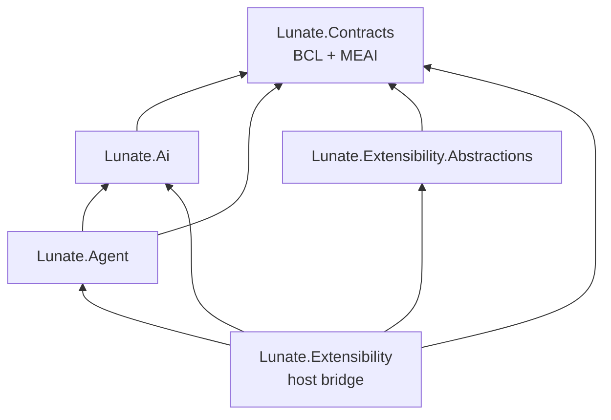

## Context

The accepted ADR-0002 addendum establishes `Lunate.Contracts` below both `Lunate.Agent` and
`Lunate.Extensibility.Abstractions`. Today Abstractions directly references Agent for tool types, and
`ToolContext`'s public signature includes additional Agent and Ai contract types. ADR-0026 is accepted
and requires the Roslyn projects to stay on the extension contract surface; ADR-0028 is proposed and
does not govern this change. The ADR inventory has no `Supersedes` declarations; the later accepted
ADR-0002 addendum is the controlling decision for this extraction.

## Goals / Non-Goals

**Goals:**

- Put the shared contract graph in a BCL/MEAI-only assembly while keeping existing namespaces and
  old assembly identities resolvable through type forwards.
- Make Agent and Abstractions depend only downward on Contracts; keep the host bridge in
  `Lunate.Extensibility`.
- Preserve extension load identity, API versioning, and existing source/binary behaviors.

**Non-Goals:**

- Implement the decision layer; this change only corrects its pending OpenSpec wording so #374 can
  put its request/result contract in Contracts and `IDecisionService` in Abstractions.
- Change event sequencing, tool execution, approvals, session format, or extension-facing behavior.
- Remove compatibility forwards before `ExtensionApi`'s next major.

## Decisions

### Dependency boundaries

`Lunate.Contracts` owns `ITool`, `ToolContext`, `ToolResult` and `ToolResultView`, tool declarations
and annotations, the complete sealed `AgentEvent` hierarchy, and the public contract types appearing
in those signatures. Moving `ToolContext` as a whole requires its public signature closure (including
event, file-change/mutation, subagent, repository-identity, model-access, model-descriptor, image and
tool-stub types) to
move as well; otherwise Contracts would reference Agent or Ai, or old compiled extensions would lose
members. Move `GitIdentity` and its BCL-only path canonicalizer with the closure because
`ToolActivationEvaluator` is implemented in Abstractions. Keep namespaces unchanged. Concrete event
channels/sinks, sequence validation, harness
execution state, and other implementations remain in their current projects. Keep Agent's
ToolContext-only internal state in an Agent-owned state object rather than introducing an Agent
reference into Contracts.

`Lunate.Ai` references Contracts only to retain/forward model descriptor types that occur in the
ToolContext signature. Agent keeps its existing Ai edge and adds Contracts. Abstractions replaces its
Agent edge with Contracts. `Lunate.Extensibility` remains the sole project that references both
Agent and Abstractions and bridges extension services to Agent implementations. No consumer-specific
adapter is added.

### Identity and publication

Each moved public type is listed in the new project's `PublicAPI.Unshipped.txt` and forwarded from
its old defining assembly. Keep the forwarders while `ExtensionApi` is 1.x; remove them only with
the next major API bump. Set `ExtensionApi.Current` to 1.14.0 and keep Contracts and Abstractions
assembly versions equal to it. Host load contexts and single-file compilation use Contracts and
Abstractions as host-owned references; Agent and Ai remain host-owned wherever a public signature
still reaches them. A real legacy extension fixture exercises the old Agent identity, and a second
test proves a copied Contracts DLL is ignored and shares the host's type identity.

The layering checker allows Agent → Contracts, Abstractions → Contracts and the existing host
composition edges, while explicitly rejecting Agent ↔ Abstractions in both directions. Roslyn and
Roslyn.BuiltIn continue to reference only Abstractions among Lunate projects; its transitive Contracts
dependency satisfies ADR-0026's boundary condition.

## Risks / Trade-offs

- [Risk] A missed public signature dependency makes the new bottom assembly fail to compile or
  breaks an old extension at load/use time. -> Move the complete public signature closure, track every
  moved type in API files, and test both legacy loading and copied-assembly identity.
- [Risk] A stale project/package manifest can reintroduce an Agent dependency or omit Contracts from
  the load boundary. -> Update solution, compile references, templates, package manifests, API
  shipping and architecture tests in the same change.
- [Risk] Type forwarding may be removed prematurely. -> Keep forwarders until the next major and pin
  old-location resolution with tests.

## Migration Plan

Move the contract types and their pure contract dependencies, add the project edges and forwarders,
then update host-owned loading and compile/package plumbing. Raise the extension API minor to 1.14.0.
No persisted data migration is needed. Rollback is a revert before publication; after publication,
restore the previous dependency layout only with an API-compatible release.

## Open Questions

None. The extra types moved are the minimum public signature closure required by the already-approved
ToolContext move and the BCL/MEAI-only Contracts boundary; no new dependency or contract shape is
introduced.
