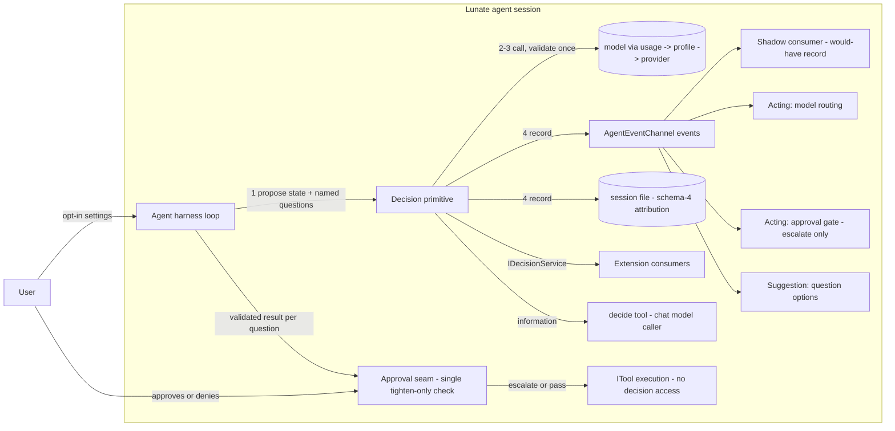

## Context

The decision path is not greenfield. Today `AgentHarness` owns an approval-shaped decision path:
`DecisionMode.Off/Shadow/Enforce` selects whether the decision profile participates in approval
asks, `EvaluateApprovalDecisionAsync` resolves the `decision` usage, calls the model with a JSON
response format, validates the response (`TryReadDecision`: one defined option, one finite
probability per option in [0, 1], summing to 1 within 1e-6), and emits `DecisionEvaluated`,
`DecisionUnavailable` and `DecisionFailed` events. Usage attribution already records the decision
method (`native` | `adapter`) and probability per the schema-4 attribution contract, and the
approval threshold sits on the model profile. #409 moves that threshold off the profile and onto the
approval consumer (`decisions.approvalsThreshold`); the profile key and its validation are removed.

The gap this change closes: the path is private and approval-shaped. The decision layer is a
**general-purpose primitive** — an abstraction over the Jev-compatible decision API — and approvals,
questions, model routing and a model-facing tool are consumers of it, not its shape.

Approved decisions that bind this design (do not re-open):

- **ADR-0027**: any model may serve the `decision` usage when the user configures it; the contract
  is checked technically; provenance records model id and `native|adapter`; malformed contracts
  retry once and then fail with the model named; shadow mode is an optional user setting; decisions
  may only tighten approvals.
- **Issue #183 maintainer comments and the 2026-10-31 sign-off**: features that consume decisions
  are opt-in settings; a question answer is never an approval; a question the user skipped while
  present is never auto-answered; "decisions may only tighten approvals, never override a deny or
  approve outside the allow envelope" holds for every model — it is a prompt-injection boundary.
- **Sign-off scope correction (2026-10-31)**: the primitive mirrors the Jev-compatible API, its
  contract is extension-facing, and 0.2 ships four consumers: model routing, the approval gate
  (escalate-only), question suggestions, and a `decide` tool for the chat model.
- **Provider store and usages (#253, merged)**: a configured decision profile is required before
  the layer proposes anything; absent one the layer reports unavailable and stays off; it never
  borrows the chat model. #409 moves the profile's selection from `usages.decision` into the
  `decisions` block (`decisions.profile`); the internal `decision` usage — attribution and `/cost`
  — keeps its name. The agent-sessions schema-4 attribution delta lives in the provider-store
  change, not in this one.

## Goals / Non-Goals

**Goals:**

- Mirror the Jev-compatible request/result contract: a state plus named questions, three question
  kinds, per-question results with distributions and provenance.
- Expose the primitive as an extension-facing service so extensions can request decisions without
  reaching into the agent's internals.
- Name the 0.2 consumers and give each one rule of action, all opt-in, all through the same
  primitive.
- Define what shadow mode guarantees: observe, record, never act.
- Enforce the tighten-only invariant in exactly one place instead of once per consumer.

**Non-Goals:**

- No code, tests or shipped API in this change; implementation follows this sign-off.
- No new usages — `decision` is already defined by `provider-store` and ADR-0027.
- No per-model calibration states, allowed-vendor lists, or required-logprobs policies.
- No approval consumer for the question tool: a question suggestion is information, never an
  approval, regardless of how it is surfaced.
- No second session-format change: attribution follows the already-approved schema-4 contract.
- No consumer-specific request types: a consumer that needs a different shape adds a kind or a
  vocabulary, never a parallel contract.

## Decisions

### D1: The request mirrors the Jev-compatible API

A request carries a **state** — free text, or a JSON value when the caller has structured state —
and **one or more named questions**, each evaluated independently against that same state. A
question optionally targets a JSON path inside a JSON state, which is how a consumer asks about one
field of a larger document without copying it.

Three kinds, and no others in 0.2:

- **yes/no** — a probability that the answer is yes; the no probability is its complement.
- **choice** — between 2 and 255 named options, one probability per option.
- **score** — an ordered rubric with at least two named levels (for example `reject`, `weak`,
  `strong`), one probability per level; order is part of the question, not the answer.

Question ids are unique within a request, because results are keyed by them. The result for each
question carries the chosen answer, that answer's probability, the full distribution, and the
provenance of the exchange (`model id`, `native|adapter`). Provenance is per exchange and repeated
on every result so a consumer never has to look elsewhere for it.

*Alternatives considered:* one "options with probabilities" shape for everything (loses the
yes/no complement and the score ordering, and makes the adapter invent semantics); one question per
request (defeats batching and multiplies model calls).

### D2: Validation is per kind, technical, and shared

One validator checks every response against the question that produced it: the answer must be one of
the question's defined answers, every defined answer carries one finite probability in [0, 1], the
probabilities sum to 1 within `DecisionProbabilityTolerance` (1e-6), and the chosen answer's
probability is its own. Kinds differ only in what "defined answers" means — `{yes, no}`, the option
labels, the rubric levels in order. A malformed response is retried once and then reported as
`DecisionFailed` naming the model and the reason; a failed attempt is never presented as a verdict.

*Alternatives considered:* per-kind validators (three copies of the same arithmetic); validating in
each consumer (the probability boundary weakens at its first unguarded consumer).

### D3: One shared validator; consumers receive validated results only

`TryReadDecision` and its retry-once-then-fail behavior move out of the approval path into the single
validator every path calls. Consumers receive a validated result or an actionable failure; they never
see raw model text, raw JSON, or invalid probabilities. Two failure modes stay apart: the layer is
unavailable (`DecisionUnavailable` — no `decision` profile configured) versus this decision is
invalid (`DecisionFailed` — the model answered, off-contract, twice).

### D4: The primitive is an extension-facing service

The contract is public surface, not an agent internal: request, question, result and answer types live
in `Lunate.Contracts`; `IDecisionService` lives in `Lunate.Extensibility.Abstractions`; the evaluator
lives in `Lunate.Agent`; and `Lunate.Extensibility` bridges the service to the evaluator. The host
registers the bridge as a core service so an extension can resolve it like any other service. This is
what makes the layer a primitive rather than an approval feature — an extension that wants a judgement
asks for one, and does not have to route through approvals to get it.

Front ends keep observing through `AgentEvent` (`DecisionEvaluated`, `DecisionUnavailable`,
`DecisionFailed`); the service is for callers that need an answer, the events are for surfaces that
need to show one. The public shape lands **before #237 publishes Abstractions as stable**, so it is
reviewed while it is still cheap to change; the additions are additive and come with the
`ExtensionApi` bump the repository requires for new surface.

Layering holds: `Abstractions` references only the bottom `Contracts` assembly, `Agent` references
`Contracts` and never `Abstractions`, and `Extensibility` is the bridge that references both. No
decision contract type mentions a provider, a tool or the loop.

*Alternatives considered:* `Lunate.Agent` types with `InternalsVisibleTo` (extensions could not use
them at all); copying agent-owned types into Abstractions (two homes, two copies); making Agent
reference Abstractions (the forbidden dependency inversion in ADR-0002).

### D5: Shadow mode records what it would have done, never acts

A shadow decision records the same validated result as any decision — the events and the schema-4
attribution — plus a consumer-local would-have record. In shadow mode a decision cannot stop or slow
a tool call, change an approval outcome, change routing, suppress a prompt, or alter any recorded
history entry besides its own attribution lines. Shadow is opt-in per acting consumer; no `decision`
profile keeps the whole layer off; the guarantee holds regardless of which model or adapter served
the decision.

### D6: Tighten-only is enforced once, at the approval seam — escalate, never block

The invariant is enforced at one place: the harness's approval seam, which knows the allow envelope,
the risk tier and the remembered grants. `DecisionMode.Enforce` is redefined as **escalate-only**:

- a `deny` recommendation on a call the envelope would allow turns that call into an ask to the
  user, showing the decision and its probability — it never silently blocks. The harness sets
  `ApprovalRequest.EscalationRequested` and carries the recommendation, probability, model id and
  `native|adapter` method, then calls `IUserPromptToolApprover.PromptAsync` directly so the normal
  envelope auto-allow cannot swallow the ask and correctness does not depend on the approver reading
  the flag. `IToolApprover`'s existing signature remains unchanged;
- in an unattended run, escalate means **deny, fail-closed**, with a notice saying the decision
  escalated and no user was present. An approver that cannot implement the prompt capability is
  treated as unattended by the harness;
- an `approve` recommendation never skips a prompt, never waives a denial, and never authorizes a
  call the tool rules exclude from any decision model.

So a decision can only narrow what runs without asking, and the user remains the only party who can
widen it.

*Alternatives considered:* veto semantics (the shipped behavior — a model silently refusing a call
the user's envelope allowed, which the sign-off replaced); consumer-side envelope checks (the
injection boundary weakens at the weakest consumer).

### D7: Boundary — the loop owns the decision; the executing tool never sees it

Per ADR-0003 the loop runs tools and owns everything between tool calls, including approvals, gates
and this record. The executor gets the tool call after the seam resolved it; a tool cannot observe
another tool's decision records, and a tool error can never be a decision failure. The `decide` tool
(D8.4) is an ordinary tool: it asks the primitive for information and returns it to the model.

### D8: The four consumers in 0.2 — all opt-in, all through the same primitive

1. **Model routing** — acting. It decides among its own options with the shared validator and
   selects the model profile for the next exchange. Shadow mode records the choice it would have
   made.
2. **Approval gate** — acting, escalate-only (D6). A deny recommendation turns an allowed call into
   a user ask; unattended it fails closed; an approve recommendation changes nothing.
3. **Question suggestions (#344)** — display only. A suggestion may be shown beside a question the
   user is answering; the user's answer grants nothing, and the answer is never auto-filled while a
   user is present.
4. **`decide` tool** — information only. The chat model hands over a state and one or more named
   questions and receives the per-question results, batched in one call. It is offered only when a
   `decision` profile is configured; its cost appears under the `decision` usage in `/cost`; and its
   result is **information, never an approval and never an answer to a user question** — a test
   pins that a decision taken through the tool grants no tool approval.

Consumer activation is a configuration property, not a registry inside the primitive: each consumer
has its own opt-in setting, and shadow mode is available for the two acting consumers as the user's
try-out tool.

### Flow of the record (lightweight C4 component view)

Diagram format follows repository precedent (one lightweight C4-inspired plain-Mermaid flowchart):

The diagram shows one primitive inside the loop's container, one seam where tightening happens, the
public service reaching extensions, and no downward call from any box into `ITool` execution.

## Risks / Trade-offs

- **[Public surface lands before Abstractions is stable]** -> that is the point of the timing: the
  shape is reviewed now, the additions are additive, and the `ExtensionApi` bump makes the change
  visible to extensions. #237's stability promise waits until this landed.
- **[Escalate semantics change shipped behavior]** -> `DecisionMode.Enforce` stops vetoing silently.
  The behavior was opt-in and under-tested; `DecisionApprovalTests` moves to escalate semantics
  rather than being deleted, so the change is pinned.
- **[A model-facing `decide` tool invites misuse]** -> it returns information only; the approval
  boundary is untouched, and a test pins that a decision grants nothing. It is offered only when the
  user configured a decision profile.
- **[255-option cap and rubric ordering constrain callers]** -> both exist in the Jev-compatible API;
  a caller that needs more splits the question.
- **[Schema-4 attribution depends on the `provider-store` delta]** -> already merged; this design
  references it instead of re-stating it.
- **[Extra decision tokens per ask]** -> the cost of any decision consumer; shadow runs model calls
  only when a `decision` profile exists, and the profile choice is the user's.

## Migration Plan

`DecisionMode.Enforce` changes meaning from veto to escalate; the setting stays opt-in, and the
change is recorded in the release notes. Implementation moves `TryReadDecision` into the shared
validator, introduces the Abstractions contract and `IDecisionService`, registers it in the agent,
wires the four consumers, and keeps `DecisionApprovalTests`' covered behaviors under escalate
semantics. Session attribution needs no new code beyond `provider-store`'s schema-4 delta; no file
move or data backfill is required.

## Sign-off

Resolved by the maintainer on 2026-10-31. The answers, recorded here so the spec delta and the tasks
can be worded as "shall":

1. **Acting-consumer scope.** All four consumers ship in 0.2, all opt-in: routing (acting), the
   approval gate (acting, escalate-only — D6), question suggestions (display only), and the `decide`
   tool (information only). Shadow remains a per-consumer try-out.
2. **The `agent-sessions` source of truth.** Confirmed: `provider-store`'s schema-4 delta lands and
   syncs first; this change only references it.
3. **The two 0027 records.** Resolved: the amended record
   (`adr/0027-provider-store-model-profiles-and-usages.md`) governs, the draft was deleted under
   #339 (PR #370), and the numbering check now guards the sequence.
4. **Public surface.** The contract is extension-facing: `IDecisionService` and its types in
   `Lunate.Extensibility.Abstractions`, implemented in `Lunate.Agent`, landing before #237 publishes
   Abstractions as stable.
