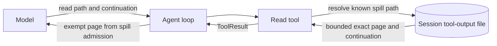

## Context

The accepted ADR-0012 addendum condition (a) already decides the behavior: spill reads paginate and are not spilled again. The current `ReadTool` returns up to 2,000 lines (which can include an arbitrarily long line), while `AgentHarness.AdmitOutput` sends every result through the token and character spill checks. Reading a large spill therefore risks returning a second spill pointer instead of the content. The current spill read allowance also recognizes any canonical path under the session's `tool-output/` directory; the accepted condition requires the exemption to identify a known spill file, not just a directory prefix.

## Goals / Non-Goals

**Goals:**

- Return token-bounded, contiguous content pages from known session spill files.
- Put an explicit continuation in each result that has more content, and use the same `read` tool for the next page.
- Keep known spill reads out of spill admission and preserve the session's path boundary.
- Prove completion, exact reconstruction, and absence of spill pointers in the dedicated large-output acceptance test.

**Non-Goals:**

- Change ordinary workspace-file reads, the spill threshold setting or estimator, spill-file format, session schema, or public .NET API.
- Add a second continuation tool or let a caller request arbitrary files outside existing read allowances.
- Change the accepted ADR-0012 condition or other context-hygiene conditions.

## Decisions

### Read known spill content as bounded contiguous slices

For known spill files, page the underlying text by a continuation offset that can advance within a long line; a line-count limit alone cannot enforce the token bound. The continuation identifies the next unread position, and page content remains an exact contiguous slice so successive pages can reconstruct the spill text byte-for-byte. Keep ordinary workspace-file `offset` behavior unchanged. Include continuation framing in the same result budget, reserving enough room for it when more content remains.

Alternatives: using only the existing line limit fails for a single long line; returning the whole file fails the bound; returning a new pointer fails to make progress.

### Use the spill admission estimator as the page budget

Apply the existing `output.spillThresholdTokens` threshold and UTF-8-bytes-divided-by-four estimator to each complete read result. Do not introduce a second threshold or token-estimation rule.

Alternative: a character or line count is not equivalent to the token estimate the spill step already uses and can exceed the configured budget.

### Exempt only a known spill path

Resolve the requested path canonically, then match it against the exact session-owned spill-file paths produced by the spill writer. Do not grant the exemption merely because a path shares the `tool-output/` prefix. Keep the existing boundary refusal for a sibling or unrelated path. The same identity rule applies to a resumed session's existing spill files.

Alternative: a directory-prefix exemption is simpler but broader than the accepted ADR-0012 decision and can exempt files that are not known spill output.

### Return the page directly from result admission

The loop's result-admission path must recognize the known-spill-read exemption and return the page unchanged instead of writing a spill file or rendering a pointer. Continuation remains data in the `read` result; another page is obtained by the next ordinary `read` call.

Alternative: allowing the page through normal admission recreates the pointer-to-a-pointer failure as soon as the page itself exceeds the spill threshold.

### Runtime flow (lightweight component view)

- The reader owns file pagination; the loop owns result admission.
- The spill file remains session-owned auxiliary output; no session transcript or schema change is needed.
- The exemption is narrower than ordinary path access: it applies to known spill files, not any file beneath a matching prefix.
- The page payload and continuation together remain under the same configured token estimate as spilling.

## Risks / Trade-offs

- **Continuation framing consumes page budget** -> reserve space for it before selecting the content slice and test the complete returned result against the threshold.
- **A byte position can land inside a multibyte UTF-8 character** -> advance only at valid decoded-character boundaries and test reconstruction with multibyte text as well as a large ASCII payload.
- **Resumed sessions must recognize their earlier spill files** -> seed the known-path set from validated files in that session's spill directory without changing session serialization.
- **The page format differs from ordinary numbered-line reads** -> limit exact-slice paging to known spill files; leave ordinary file-read presentation unchanged.

## Migration Plan

No persisted data migration is required. Existing spill files remain readable after resume; no session schema or spill-file bytes change. Rollback is a code revert and leaves the existing auxiliary spill files intact.

## Open Questions

None. The design follows accepted ADR-0012 addendum condition (a); it adds no public API, dependency, or new architectural policy.
