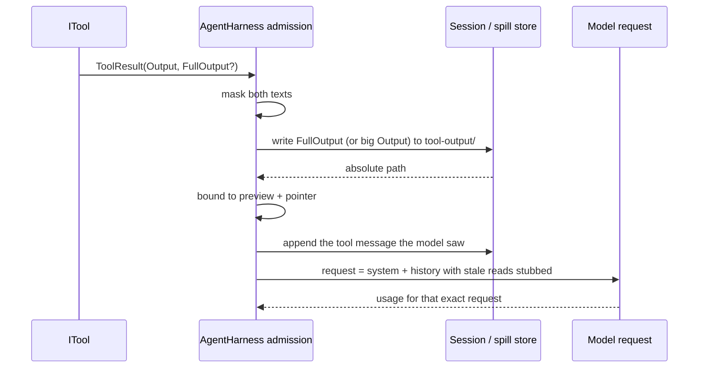

# Design — context hygiene

## Context

The loop already has most of the machinery this change needs; the gap is where the decisions are made. The inventory below is the code as it is on `origin/main` (`ef643581`), not the guide.

### What is true today

| Behaviour | What exists | The gap |
| --- | --- | --- |
| Spills | `ToolOutput.DefaultLimit` is 30,000 **characters** (`src/Lunate.Agent/ToolOutput.cs:14`). The loop spills only when `output.Length > ToolOutputLimit` (`src/Lunate.Agent/AgentHarness.Tools.cs:95-121`), writing the full text to `<sessions-dir>/<session-id>/tool-output/<run>-<seq>.txt` (`src/Lunate.Agent/ToolOutputSpill.cs:24-34,37-99`), owner-only, LF, UTF-8 without BOM, 64 MB ceiling (`:19`), redacted at rest (`:48`), best-effort on failure (`:90-98`). The in-band text stays a 30,000-character head/tail with a marker (`ToolOutput.cs:31-64`). | 30,000 characters is about 7,500 tokens and still occupies the window. The threshold is in characters, not the tokens the rest of the loop estimates with. The marker names an absolute path the `read` tool refuses: `ReadTool` only resolves workspace paths (`src/Lunate.Coding/ReadTool.cs:98-104`) or the skill allowance (`:234-270`), and the sessions directory is neither. The agent-tools spec's "`read` on it returns the full content" is therefore false. |
| Concise results | `ToolResult.Output` is the only model-facing text; `Details` is UI-only; `StructuredContent` is typed content (`src/Lunate.Agent/ToolResult.cs:14-34`). `bash` composes all of stdout, stderr and the exit footer into `Output` (`src/Lunate.Coding/BashTool.cs:158-170`) after capturing up to 1 MB (`:17`). | A tool cannot say "this is the answer; that is the transcript". Everything a large command printed goes through the same truncation path, so the model pays for the transcript and the answer is cut by the same head/tail rule. |
| Stale reads | The system prompt states "read a file before you edit it" (`src/Lunate.Agent/system-prompt.md`), but `edit` matches `old_text` against whatever is on disk now (`src/Lunate.Coding/EditTool.cs:154-279`) and neither it nor `write` knows what the model last read. Successful mutations are published as `FileChangeEvent`s (`src/Lunate.Coding/EditTool.cs:251-259`, `src/Lunate.Coding/WriteTool.cs:140`), and the harness wraps the sink per run (`src/Lunate.Agent/IFileChangeSink.cs:55-60`, `AgentHarness.Tools.cs:521-525`). | A model that read version 1, edited to version 2 and then edits again from its memory of version 1 is trusted. The old read also stays in the request at full size even though the edit made it wrong. |
| Masking | `CredentialRedactor` replaces **exact values** Lunate holds with `[redacted:<name>]` (`src/Lunate.Ai/CredentialRedactor.cs:54-67,92`). It runs at persistence: session writes (`src/Lunate.Agent/Session.cs:552,561`), spill writes (`ToolOutputSpill.cs:48`) and exports. The loop itself never masks (`AgentHarness.Tools.cs:65-74`); `Session.cs:56-61` and `HarnessFactory.cs:245-249` say so explicitly: the in-memory result keeps what the model saw. | The secret reaches the provider in the request. A `--no-session` run has no redactor at all. |
| Accounting | Provider usage is recorded per assistant message and emitted as `UsageUpdated` (`src/Lunate.Agent/AgentHarness.cs:663-676`); the request estimate is UTF-8 bytes / 4 (`src/Lunate.Agent/CompactionReducer.cs:253-283`) and drives compaction. | The estimate is over the history as currently admitted (30,000 characters), and no test attributes a change in it to context hygiene. |

### The boundary this change introduces

One admission path for every tool result, in this order:

```
ITool.ExecuteAsync
        │  ToolResult(Output, FullOutput?, Details)
        ▼
AgentHarness admission  ── mask ──▶ project (FullOutput) ──▶ spill ──▶ bound to pointer
        │
        ├─▶ ToolCallResult event (the text the model saw)
        ├─▶ history + session entry (the same text)
        └─▶ spill file (masked full text, owner-only, session directory)
                                     │
ReadLedger ◀── FileChangeEvent ──────┘   (invalidate/supersede reads)
        │
        └─▶ in-memory history: superseded read results become one-line notices
```



Responsibilities: `ITool` owns the answer and, when it has one, the transcript (`FullOutput`); the loop owns masking, spilling, the bound and the read ledger; `Session` owns the bytes at rest and the append-only entry; the harness owns the stale-read replacement in its in-memory history. The model owns nothing except reading the file it was pointed at.

## Goals / Non-Goals

**Goals**

- A large tool result costs a pointer, not the window, and the model can page the full text with `read`.
- A tool can send its answer while the transcript goes to the spill file, without the loop guessing which lines matter.
- A read that an edit invalidated is never trusted silently, and its stale copy stops occupying the request.
- A known credential never enters the model request, the event stream, the session entry or the spill file.
- Every effect is measurable in the session's token accounting with a test that fails on today's code.

**Non-Goals**

- Pattern-based secret detection. The repository's rule is exact value only (`CredentialRedactor.cs:5-14`); changing it is a separate decision.
- A session format change. The projection is request-time; the session keeps the entry it appended.
- Model-summarised tool results. Concision is tool-authored, not generated with another model call.
- Sweeping spill files, changing image handling, or touching MCP tool wrappers beyond the existing truncation path.

## Decisions

### D1 — Admission order: mask first, then project, spill and bound

Masking is the first step, because everything downstream persists or emits text: the event, the session entry, the spill file. Masking after truncation could split a secret across the cut and leave the fragment unmasked; masking at request-build time would leave the raw text in the session. `FullOutput` is masked with the same function as `Output`.

Alternatives: mask only at request build (the session would still hold raw text, and the event would show it); mask in each tool (every tool must remember, and third-party tools will not). The loop is the one place every tool result passes.

### D2 — The spill trigger is estimated tokens; the character cap stays

`AgentHarnessOptions.SpillThresholdTokens` (default **2,000** estimated tokens, exposed as `output.spillThresholdTokens` and `LUNATE_TOOL_SPILL_THRESHOLD`) decides when a result is spilled. The estimate is the loop's existing one: UTF-8 bytes / 4 (`CompactionReducer.cs:253-283`). `ToolOutputLimit` (chars, default 30,000) stays as the absolute fallback cap when there is no session, when a write fails, or when the result is too large to spill. Whichever limit is hit first applies.

Why not keep one character limit: 30,000 characters allows a 7,500-token result through, and lowering the user-facing `toolResultLimit` would change what it means for every existing settings file. Why not a percentage of the model window: the same result should spill on a 32k and a 200k model; the threshold is about one result's usefulness, not the whole window. Why not always spill: a one-line answer must not cost a file read.

Default rationale: 2,000 tokens is roughly 8,000 characters or 20 lines of dense output — above the point where a result usually answers the question on its own, below the 30,000-character cap.

### D3 — The in-band text is a bounded preview plus an actionable pointer

For a result without `FullOutput`, the pointer body keeps the first and last 10 lines, at most 2,000 characters total, then a marker:

```
... [12,431 characters / 3,108 tokens; 482 lines; full output at /…/tool-output/run_…-3.txt; read it with offset and limit] ...
```

The preview keeps the head and the tail because build logs, diffs and test runs put the summary at one end; the old design already chose head+tail for that reason. The marker carries the numbers in `CultureInfo.InvariantCulture`, the path, and the next action. For a result with `FullOutput`, the answer is already in-band, so the marker is one line and has no preview.

Alternatives: an empty pointer (cheapest, but every large result costs a round trip even when the first line was the answer); today's 30,000-character head/tail (the reported problem); head only (loses the summary the tail usually holds).

### D4 — The spill file is readable through `read`, granted per run

`ReadTool` gets the session's canonical `tool-output` directory as an extra read root for the run, next to the skill allowance it already has (`ReadTool.cs:234-270`). `HarnessFactory` grants it when a session is attached, and on resume after the session is loaded. A child run gets its own session directory, never the parent's. The grant is one canonical directory: `read` does not follow a path out of it, and the file names are generated (`<run>-<seq>.txt`).

Alternatives: spill inside the workspace (pollutes the user's tree and `.gitignore`); let `read` accept any absolute path (breaks ADR-0016's workspace boundary); teach `read` a special marker syntax (a second read path to secure). The allowance already exists for skills and is the smallest change: it is a list of roots, checked canonically.

### D5 — The tool owns concision; the loop never guesses

`ToolResult.FullOutput` is the transcript behind a concise `Output`. The loop spills `FullOutput` (masked) and appends the pointer; it never rewrites the tool's `Output` except for masking and the bound. When `FullOutput` is null or equal to `Output`, the result behaves exactly as today. Without a session there is nothing to point at, so the loop appends the bounded `FullOutput` (today's head/tail marker) instead of silently dropping it.

Adopters in this change: `bash` — `Output` is stderr, the exit footer and the last 20 stdout lines (at most 2,000 characters); `FullOutput` is the composed stdout+stderr as today. The other core tools already answer in `Output` (edit names the lines it changed, grep is bounded, the C# tools summarise) and keep their behaviour. MCP tools are a follow-up: their output is arbitrary, and the wrapper needs its own rule.

Alternatives: error-keyword heuristics in the loop (they silently drop the one line that mattered, and there is no principled test); an LLM summary per tool result (a second model call, more tokens and latency, and a lossy answer the tool could have given directly); prompt instruction only (today's state, no enforcement).

### D6 — Reads are versioned; a stale version is refused and its copy is stubbed

A harness-level `ReadLedger` (one per session history, stamped into each run's `ToolContext`; internal to `Lunate.Agent` and the `lunate` assembly) records every text `read` as `(canonical path, SHA-256 of the LF-normalised text, call id)`. The digest is computed from the text `ReadTool` already reads (`ReadTool.cs:143`), so recording costs no extra I/O.

- The **newest** read of a path is the live version. Every older read result of that path is superseded: the harness replaces its tool-result text in the in-memory history with one line, e.g. `[stale: superseded by a later read of src/Foo.cs; this copy is no longer current]`. The session entry keeps the original text (append-only); only the request shrinks.
- `edit` and `write` compute the digest of the text they already read inside the mutation queue (`EditTool.cs:154-170`, `WriteTool.cs:100-130`) and ask the ledger for the live version. A matching live digest allows the mutation. An invalidated record — a `FileChangeEvent` from any source, including bash's git scan (`BashTool.cs:178-214`) — or a digest mismatch (an out-of-band change) refuses with: `src/Foo.cs changed after your last read (an edit, bash, or another process). Re-read it and base old_text on the current text.` The refusal is an error result, not an exception, and names what to do.
- A path the ledger never saw is allowed, exactly as today. The rule is "do not trust a read that has been invalidated", not "you must have read it" — so tools and tests outside the loop, and the first edit of a file, keep their behaviour.
- The sink wrapper (`IFileChangeSink.cs:55-60`) invalidates on every published mutation, whatever the source; the digest catches writers that publish nothing.
- On resume the ledger is empty, so it is **seeded from the loaded history**: every `read` call in the chain gets an unknown-version record, and the first edit of that path asks for a re-read. The first re-read supersedes the seeded copy and stubs it; correctness survives resume, and the projection catches up one read later.

Alternatives: refusal only (correct but the stale copy still occupies the window and a re-read doubles it); rewrite the session entry (breaks append-only and the replay contract); persist versions in the session (a format bump; a follow-up, not this change); refuse when no read exists (beyond the issue and breaks the direct-tool tests).

### D7 — Masking before context: exact values, one delegate

`AgentHarnessOptions.ToolOutputMask` is a `Func<string, string>?` applied to `Output` and `FullOutput` before anything else. `HarnessFactory` passes the session redactor's `Redact` when a session exists, and builds the same `CredentialRedactor` from the auth store, environment, extension secrets and MCP config for a `--no-session` run (`HarnessFactory.cs:251-276`), so both modes mask. The marker is `[redacted:<name>]`, already defined by `CredentialRedactor.Marker` (`:92`); the masker is idempotent, so the at-rest pass changes nothing.

The tool result's `Details` is UI-only and is not masked here; a diff that contains a secret is a separate UI question (Open Questions). Assistant text is not masked; the model can only echo what it saw, and after this change it does not see masked values.

Alternatives: an `ITextMasker` interface (more ceremony for one method; the delegate is plain code and the harness treats null as identity); pattern guessing (rejected for the same reason the at-rest rule rejects it: false negatives teach trust, false positives mangle code); a per-tool mask (every tool must remember).

### D8 — The accounting test uses the product's own estimator

The tests use a fixture `IChatClient` that reports `InputTokenCount = Utf8Length(request) / 4` and `OutputTokenCount` fixed; the same helper is the loop's estimate. Each behaviour's test reads the `UsageUpdated` event and the `SessionUsage` on the assistant entry, and asserts an absolute ceiling that today's code misses. No token number is hand-written against a string assertion: the number is the measured size of the request the provider received.

| Behaviour | Fixture | Today | After (asserted) |
| --- | --- | --- | --- |
| Spill | a tool returns 9,000 characters (under the old 30k cap, over the new threshold) | ~2,250 input tokens, no spill file | < 700 tokens, marker with path, file readable by `read` |
| Concise | `bash` prints 20,000 characters of stdout and one stderr line | ~5,000 tokens, stdout in the request | < 700 tokens, stderr in the request, transcript in the spill file |
| Stale | read 2,000 lines, edit, then a second edit from the old text | the old read stays in the request; the second edit is accepted | the old read is a one-line notice; the second edit is refused and names the re-read |
| Masking | a known 2,048-character credential in a tool result | the request carries it (512 tokens) | `[redacted:<name>]` in the request, event and file; the recorded input count drops by the byte delta |

The first three deltas are large enough to be the product effect; masking's delta is small by nature (a real key is tens of characters), so its test asserts the marker and that the recorded count equals the estimator over the masked request — the secret's bytes are not billed. Saying that plainly is better than pretending masking is a big token win.

## Code touched

| File | Change |
| --- | --- |
| `src/Lunate.Agent/ToolResult.cs` | `FullOutput` (optional) with the contract doc. |
| `src/Lunate.Agent/ToolContext.cs` | Internal `Reads` (the per-call ledger view), null outside a run. |
| `src/Lunate.Agent/IReadLedger.cs` (new, internal) | `Record(path, digest)` and `Check(path, digest)` returning an instructing refusal or null. |
| `src/Lunate.Agent/ReadLedger.cs` (new) | Live/superseded records per canonical path, invalidation, resume seeding, superseded call ids for the projection. |
| `src/Lunate.Agent/ToolOutput.cs` | `EstimateTokens` and the pointer rendering; `Truncate` stays for the fallback. |
| `src/Lunate.Agent/ToolOutputSpill.cs` | Reuse `DirectoryFor` for the read grant; no format change. |
| `src/Lunate.Agent/AgentHarness.Tools.cs` | Admission: mask, `FullOutput`, spill, pointer; stamp `Reads`; wrap the sink to invalidate. |
| `src/Lunate.Agent/AgentHarness.cs` | Seed the ledger on resume; replace superseded read results in `_history` and keep `_historyUtf8` exact. |
| `src/Lunate.Agent/AgentHarnessOptions.cs` | `SpillThresholdTokens`, `ToolOutputMask`. |
| `src/Lunate.Coding/ReadTool.cs` | Record the read; accept the session's `tool-output` root. |
| `src/Lunate.Coding/EditTool.cs`, `WriteTool.cs` | Check the live version before mutating. |
| `src/Lunate.Coding/BashTool.cs` | `FullOutput` (stdout transcript) and the concise `Output`. |
| `src/Lunate.Coding/HarnessFactory.cs`, `InteractiveSession.cs`, `PrintMode.cs` | Wire the masker and the threshold; grant the spill root. |
| `src/Lunate.Coding/SettingsStore.cs` | `output.spillThresholdTokens` (positive integer, culture-invariant). |
| `src/Lunate.Agent/PublicAPI.Unshipped.txt` | The three public additions (`FullOutput`, `SpillThresholdTokens`, `ToolOutputMask`); the ledger stays internal. |
| `docs/guide.md` | What is now true about truncation, redaction and reads (implementation task). |
| `adr/0012-addendum-context-hygiene.md` (new, proposed) | The admission boundary and the contract additions. |

## Risks / Trade-offs

- **One public contract addition (`FullOutput`), two options and a reversed redaction boundary** → they are the reason this is a proposal, not a patch; ADR-0012 addendum is marked proposed and the PR asks for sign-off. Nothing merges before that.
- **A 2,000-token threshold is aggressive** → the setting is configurable; the preview keeps both ends; the pointer names the path and the next action. A user who wants today's behaviour raises `output.spillThresholdTokens`.
- **The model can no longer copy a secret it reads** → that is the point of masking; the marker names the credential, so the model can ask the user or use a placeholder. If a workflow needs the literal value, the user supplies it.
- **A formatter or watcher that rewrites a file between read and edit refuses every edit** → the content digest is honest: the text really changed, so a re-read is required. The refusal names the source, and the re-read is one call.
- **Masking cost on large outputs** → the redactor is O(values × text) and already runs on every spill write; moving it earlier does not add a pass, and the Agent suite measures the tool-result path.
- **The projection changes the request prefix** → a stubbed read invalidates the provider's prompt cache for that suffix; it happens once per superseded read and saves far more than it costs.
- **Resume loses the projection until the next read** → correctness is preserved by seeding the ledger; the stale copy is stubbed when the re-read arrives. Persisting versions would need a session format bump (Open Questions).
- **Spill files are not swept** → disk growth, not context growth; a follow-up change, like the image sweep.
- **`FullOutput` memory** → held only for the duration of the call and capped by the spill ceiling; over the ceiling the pointer says the transcript was too large to keep.

## Migration Plan

Defaults on, no session schema change, no golden update expected. A session written by this version still loads on the previous one (the entries are ordinary tool messages with pointer text; the spill directory is auxiliary). Rollback is a revert; the only persisted effect is spill files, which a session never treats as transcript state.

## Open Questions

- **Sign-off:** `ToolResult.FullOutput` and masking before the context reverse part of the #196 decision. ADR-0012 addendum records them as proposed; the maintainer accepts or rejects before apply. The read ledger is internal between the loop and the core file tools (both in the `lunate` assembly via internals access), so it adds no public surface.
- **Pattern-based masking** for secrets Lunate does not hold (a `.env` read): a follow-up change with its own ADR, or never? This design keeps exact-value only, matching the written rule.
- **Persisting read versions** in the session would keep the stale-read projection across resume and remove the seeded re-read. It needs a session format bump and golden work; not this change.
- **Masking `Details`** (a diff of a secret file) for the UI: the diff is UI-only, but a terminal scrollback is still a leak surface.
- **Sweeping `tool-output`** with the session (as images are swept) or leaving it to the OS; disk hygiene, not context hygiene.
