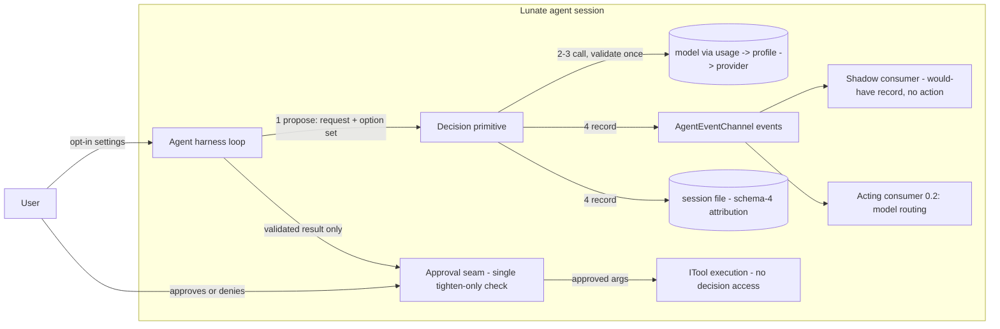

## Context

The decision path is not greenfield. Today `AgentHarness` owns an approval-shaped decision path:
`DecisionMode.Off/Shadow/Enforce` selects whether the decision profile participates in approval
asks, `EvaluateApprovalDecisionAsync` resolves the `decision` usage, calls the model with a JSON
response format, validates the response (`TryReadDecision`: one defined option, one finite
probability per option in [0, 1], summing to 1 within 1e-6), and emits `DecisionEvaluated`,
`DecisionUnavailable` and `DecisionFailed` events. Usage attribution already records the decision
method (`native` | `adapter`) and probability per the schema-4 attribution contract, and
`ModelProfile.DecisionThreshold` is validated for well-formedness.

The gap this change closes: the path is private and approval-shaped rather than a reusable
Jev-shaped primitive — propose → validate → decide → record — that different consumers can use, and
that shadow-mode consumers can observe without acting on.

Approved decisions that bind this design (do not re-open):

- **ADR-0027 (both accepted records, and the maintainer sign-off for `provider-store`)**: any model
  may serve the `decision` usage when the user configures it; the contract is checked technically;
  provenance records model id and `native|adapter`; malformed contracts retry once and then fail
  with the model named; shadow mode is an optional user setting; decisions may only tighten
  approvals.
- **Issue #183 maintainer comments**: features that consume decisions are opt-in settings; a
  question answer is never an approval; a question the user skipped is never auto-answered while a
  user is present; the invariant "decisions may only tighten approvals, never override a deny or
  approve outside the allow envelope" holds for every model — it is a prompt-injection boundary.
- **0.2 scope (maintainer decision 2026-10-28)**: the primitive, a chat-model adapter, shadow
  consumers, and model routing as the only active consumer. Consumers beyond that wait for 0.3.
- **Provider store and usages (#253, in flight as the `provider-store` change)**: `decision` is an
  existing usage; selection is usage → profile → provider; no decision profile means the layer
  reports unavailable and stays off; it never borrows the chat model; `adapter:<provider>/<model>`
  profiles are an explicit, labelled choice. The agent-sessions schema-4 attribution delta lives in
  that change, not in this one.

## Goals / Non-Goals

**Goals:**

- Define the primitive's shape: the request and result contracts, the option set and probability
  representation, and what is recorded on every decision.
- Define what a consumer sees: an event-only observation surface plus one acting role, so the same
  decision can be expressed by different front ends and consumers.
- Define what shadow mode guarantees: observe, record, never act.
- Define where the boundary sits: the harness loop proposes, validates, decides and records; the
  executing tool never sees or exercises a decision.
- Enforce the tighten-only invariant in exactly one place instead of once per consumer.

**Non-Goals:**

- No code, tests or public API in this change; implementation follows maintainer sign-off.
- No new usages — `decision` is already defined by `provider-store` and ADR-0027.
- No per-model calibration states, allowed-vendor lists, or required-logprobs policies.
- No approval consumer for the question tool: a question suggestion is information, never an
  approval, regardless of how it is surfaced.
- No second session-format change: attribution follows the already-approved schema-4 contract in
  the `provider-store` delta.

## Decisions

### D1: One primitive, four phases, agent-owned types in `Lunate.Agent`

The primitive is a four-phase sequence — **propose → validate → decide → record** — owned by the
harness loop, with its contracts as `Lunate.Agent` types. `Lunate.Agent` already owns the loop and
the events; putting the contracts anywhere else either creates an upward reference or a parallel
message type, which the architecture forbids. The request names the three things any consumer
needs: the **usage** being served (`decision`), the **subject** being decided (an approval ask
today, a routing choice later), and the **option set** the subject admits. The result carries the
chosen option, its probability, the full option-probability set, the resolved model id, and the
`native|adapter` method label — everything `/cost` and the transcript show today.

Alternatives considered: contract types in `Lunate.Ai` (would need `Agent` → `Ai` types in event
streams consumed by `Tui`, and `Tui` references no Lunate project); keeping the contract
approval-specific (that is the current gap, not a design).

### D2: The contract is option-set-generic; approve/deny is one instance

Validation takes the option set from the request, not from a fixed pair: exactly the defined
options, one finite probability in [0, 1] per option, summing to 1 within the existing
`DecisionProbabilityTolerance` (1e-6), and the chosen option must be one of them and must carry its
own probability. The approval ask is the first instance with the option set `{approve, deny}`;
model routing decides among its own options with the same validator and no per-instance code.
The JSON shape of the model response is the shape that exists today — `option` plus a
`probabilities` object — generalized to N options.

Alternatives considered: keeping `approve`/`deny` hardcoded in the validator (works today, but the
second consumer re-derives or forks the contract, which is what this change exists to prevent);
requiring raw logprobs (forbidden: no required-logprobs policy).

### D3: One shared validator; consumers receive validated results only

`TryReadDecision` and its retry-once-then-fail-with-the-model-named behavior move out of the
approval path into a single validator that every consumer path calls. Consumers receive a
`DecisionEvaluated`-shaped validated result or an actionable failure; they never see raw model
text, raw JSON, or invalid probabilities. Two failure modes stay apart, as ADR-0027 requires: "the
decision layer is unavailable" (`DecisionUnavailable` — no `decision` profile configured) versus
"this decision is invalid" (`DecisionFailed` — the model responded, but off-contract, twice).
A malformed response is retried once; the failing attempt is never presented as a verdict.

Alternatives considered: validation at the consumer (every consumer re-validates; the probability
boundary weakens at its first unguarded consumer).

### D4: What a consumer sees — events for observation, one acting role

A consumer either **observes** or **acts**, and activation is configuration, not code:

- **Observation** is the existing extension-event surface: `DecisionEvaluated`,
  `DecisionUnavailable`, `DecisionFailed` carry run id, model id, method, option and probability.
  Front ends (TUI, print mode, exports, tests) already read these; no new channel is added.
- **An acting consumer** is registered through an opt-in setting and does exactly one thing with a
  validated result: it applies the action its subject admits, under the tighten-only boundary of
  D6. Shadow consumers observe with the same events.
- **Suggestion-only consumers** (question-suggested option, future ranking consumers) may filter or
  reorder what a prompt shows, but **nothing chosen through a question approves a tool call**;
  approvals stay a separate prompt. A question the user skipped while present is never
  auto-answered from a decision.

Consumer registration order (tool gate, approval gate, question-suggested option) is therefore a
configuration property of the consumer, not a registry inside the primitive; 0.2 keeps the acting
set at model routing only, pending the sign-off in `Sign-off (blocking)` item 1.

Alternatives considered: a synchronous consumer registry with call-back rights into the harness
(gives shoppers of decisions veto/censor power the harness cannot see; violates the single-boundary
goal); TUI-direct consumption (would need `Tui` → `Agent`, forbidden).

### D5: Shadow mode records what it would have done, never acts

A shadow-consumption decision records the same validated result as any decision — the events and
the schema-4 attribution (`usage`, profile, provider, resolved model id, method, probability) —
plus a consumer-local would-have record (e.g. "would have vetoed the ask"). In shadow mode a
decision cannot: stop or slow a tool call, change the approval outcome, change routing, suppress a
prompt, or alter any recorded history entry besides its own attribution lines. Shadow is opt-in
per the approved settings; no `decision` profile keeps the whole layer off; and every shadow
guarantee holds regardless of which model or adapter served the decision.

Alternatives considered: recording decisions only in logs (loses provable guarantees — the
regression proof is exactly that session and event streams are unchanged apart from decision
records); a shadow mode that gates only when the model is very confident (re-introduces per-model
calibration, which is forbidden).

### D6: Tighten-only is enforced once, at the approval seam in the harness

The invariant — a decision may only tighten the user's allow envelope; it never overrides a deny
and never approves outside the envelope — is enforced at one place: the harness's approval seam,
which already knows the allow envelope, the risk tier and the remembered grants. Consumers receive
a recommendation; the seam maps it to the allowed tightening. Concretely: a `deny` recommendation
can veto an ask that would otherwise be allowed; an `approve` recommendation can never waive a
denied ask, never skip a prompt, and can never authorize a high-risk call that `agent-tools`
already excludes from any decision model. Because the seam is single, the invariant is testable at
one seam and holds no matter which consumer requested the decision.

Alternatives considered: each consumer re-implements the envelope check (the injection boundary
weakens at the weakest consumer); enforcement at the executor (see D7 — tools must not decide).

### D7: Boundary — the loop owns the decision; the executing tool never sees it

Per ADR-0003 the loop runs tools and owns everything between tool calls, including approvals,
gates, panels and this record. The executor gets the tool call after the seam has resolved it;
a tool cannot call the decision primitive, cannot observe another tool's decision records, and a
tool error can never be a decision failure. The tool's own ask (if it prompts the user) is the
ordinary approval path.

Alternatives considered: executor-owned decisions (splits the invariant's enforcement across
extension code that the harness does not own); tool-side re-asks (duplicates the envelope).

### Flow of the record (lightweight C4 component view)

Diagram format and rigor are already settled by repository precedent (`adr-numbering` and other
approved designs use one lightweight C4-inspired plain-Mermaid flowchart), so a Mermaid flowchart is
used here:

The diagram shows: one primitive inside the loop's container, one seam where tightening happens,
tools and shadow consumers on the consumer side of the record, and no downward call from any box
into `ITool` execution.

## Risks / Trade-offs

- **[The acting-consumer scope is ahead of the approved comment]** -> the existing
  `DecisionMode.Enforce` veto path is an acting approval consumer, while the approved 0.2 scope
  says model routing is the only acting consumer. The design supports both through one contract;
  which consumer 0.2 ships active is `Sign-off (blocking)` item 1.
- **[Generic option sets weaken the approve/deny fast-path tests]** -> the existing validation
  tests pin two options; N-option contract tests keep the same failure modes (`DecisionApprovalTests`
  behaviors move rather than disappear).
- **[Schema-4 attribution depends on the `provider-store` delta landing first]** -> the design
  references rather than duplicates it; the lane order and `Sign-off (blocking)` item 2 handle the
  dependency.
- **[Extra decision tokens per ask]** -> already the cost of the current approval path; shadow mode
  runs model calls only when a `decision` profile exists, and the profile choice is the user's
  (no model is borrowed).

## Migration Plan

This change records no runtime migration. Implementation, when the sign-off opens the lane
(after #187, #184, #186 — see #183 order comment), moves existing validation into the shared
validator, introduces the request/result contract, and keeps `DecisionApprovalTests`' covered
behaviors while adding contract-generic cases. Session attribution needs no new code beyond what
`provider-store` already specifies; no formatting normalization, file move or data backfill is
required by this design.

## Open Questions

All open questions for the maintainer are listed under `Sign-off (blocking)`; this card stops
there and does not implement.

## Sign-off (blocking)

Maintainer sign-off is required before implementation starts; these are the open items:

1. **Acting-consumer scope for 0.2.** The approved 0.2 scope comment (2026-10-28) says model
   routing is the only consumer that acts, but current code already has an acting approval
   consumer: `DecisionMode.Enforce` lets a decision veto an approval ask
   (`AgentHarness.Tools.cs`, `DecisionApprovalTests`). Decide whether 0.2 keeps the approval gate
   as an acting consumer (as shipped), demotes it to shadow-only until 0.3, or makes the mode
   config-gated with routing as its second consumer. The design supports any of the three through
   one contract, but the spec delta needs a decision before its requirements can be worded as
   "shall".
2. **The `agent-sessions` source of truth.** The main spec (`openspec/specs/agent-sessions/spec.md`)
   still says the current schema is 3 and supports 1–3, while `SessionFormat.SchemaVersion` is 4,
   both accepted ADR-0027 records approve schema-4 decision attribution, and the schema-4 delta
   lives in the in-flight `provider-store` change. Decide (or confirm by merging `provider-store`
   ahead) that `provider-store`'s agent-sessions delta lands and syncs before this change's
   apply step touches session attribution, so this change never re-states schema behaviour that
   another delta already owns.
3. **The two accepted 0027 records.** `adr/0027-provider-store-and-model-profiles.md` and
   `adr/0027-provider-store-model-profiles-and-usages.md` are both accepted and duplicate the
   0027 number; the `adr-numbering` change already blocks the docs gate on this. If they ever
   diverge on decision-layer wording (method labels, retry-once, tighten-only), the maintainer
   should name which record governs; the duplicate-number resolution itself belongs to #339's
   follow-up, not to this change.
4. **Public surface of the primitive.** The request/result contract types are `Lunate.Agent` types;
   decide at sign-off whether they are public (added to `PublicAPI.Unshipped.txt`) or internal,
   given that front ends consume decisions through `AgentEvent` events and configuration, not
   through the contract types directly.
