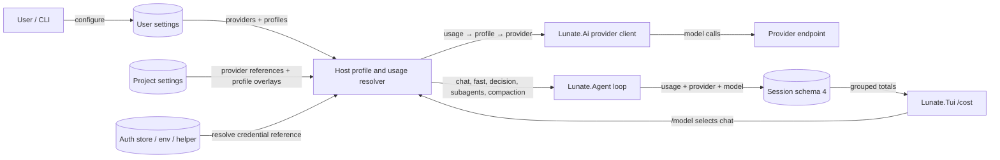

# Provider Store Design

## Context

Today `Lunate.Ai` loads twelve provider presets and a model catalog; `AuthStore` keeps named keys; user settings may carry custom OpenAI-compatible providers; and one model id is selected for the session. `AuthCommand.List` enumerates preset and stored-key names without endpoint reachability, `/model` switches the one active model, compaction uses that same model, and `UsageCost` groups recorded token lanes by model rather than semantic usage or provider. These current paths establish the configuration and attribution gap this proposal addresses. Extension model providers and virtual models are a separate registry; the `model-router` sample already owns its per-request routing inside a declared provider.

The requested `openspec/project.md` is not present in this checkout. Capability names below follow the existing `openspec/specs/` directories and the configured OpenSpec instructions.

The change introduces user-owned provider instances, named profiles, and usage selection across `Lunate.Ai`, `Lunate.Agent`, settings/auth, sessions, and the TUI. Security and migration are central constraints: a project repository is untrusted input, secrets stay in the existing secret store or an external source, and the session format is pinned by ADR-0015. ADR-0022 records the current preset/auth model and must be revisited for the new provider instance and profile semantics. No in-force ADR is superseded in the repository; ADR-0008 only supersedes one release-row wording in ADR-0001.

## Goals / Non-Goals

**Goals:**

- Make provider instances user-owned data, with credentials represented only by references.
- Validate named profiles against provider and catalog capabilities before a client is used.
- Resolve all model calls through an explicit usage, profile, and provider assignment.
- Make decision capability and adapter provenance visible, and make the no-profile case explicitly unavailable.
- Attribute persisted usage and `/cost` to usage and provider while retaining model id and token-lane pricing behavior.
- Reject project settings that could redirect user credentials, while allowing project profile references and only-tightening limits.

**Non-Goals:**

- Defining a region-based data-routing or residency policy; `region` is retained metadata only.
- Adding a core per-request routing DSL or changing how a declared provider routes internally.
- Adding provider kinds beyond the twelve existing templates or new NuGet dependencies.
- Silently adapting unsupported settings, implicitly falling back to the chat model for decisions, or treating adapter results as calibrated.

## Decisions

### Provider templates and instances are separate

Keep the existing twelve preset definitions as provider-kind templates for adapter selection and defaults. Store named provider instances in user settings, each with kind, base URL, credential reference, optional headers, and region. An instance may override its template endpoint and credential source; its secret is resolved only by the existing host-side credential path at request time. Existing stored keys are migrated idempotently into matching provider entries without copying the value or replacing explicit entries. The environment remains the highest-precedence credential source for CI overrides.

**Alternative considered:** Treat each preset as the provider instance. Rejected because it cannot express multiple endpoints or credential sources for one kind and conflates defaults with user-owned endpoints.

### Profiles are validated at the configuration boundary

Profiles bind a name to one provider and one catalog model. Resolve the provider/model first, then validate each configured reasoning, output, temperature, context-window, and decision-threshold setting against the model/provider metadata before constructing a client. A failure reports the profile and unsupported field. Do not drop unsupported values or pass them through hoping that an adapter will ignore them. A valid context-window override affects that profile only; it does not mutate the catalog.

**Alternative considered:** Validate options only when a request is sent. Rejected because bad configuration would fail late and could silently alter behavior if an adapter discards the option.

### Core routes usage to profiles to providers

Keep the selection graph explicit: `chat`, `fast`, `decision`, `subagents`, or `compaction` selects a profile; the profile selects a provider and model; the provider owns adapter behavior and any per-request routing. `/model` changes only chat. An explicit `provider/model` selection uses that provider's default settings; a bare model id is accepted only if unique. The `model-router` sample remains the reference for routing inside a provider. No general routing language or core router is introduced.

`subagents` and `compaction` have explicit usage defaults; absent a subagent assignment, a child uses chat. Compaction resolves to chat by default and can use fast only when explicitly configured. The chat default is intentional because a faulty summary changes the context used to continue the session; speed is not worth silently selecting a weaker summary model. All resulting usage records retain the semantic usage name even when the underlying profile is shared.

**Alternative considered:** Route models per request from a central rule table. Rejected because it duplicates the provider's routing responsibility and hides which model receives a call.

### Decision capability is declared and degradation is explicit

At configuration time, assignment to `decision` is refused only if the selected model's metadata explicitly says structured output is unsupported. Unknown capability proceeds to runtime validation; neither `apiType`, provider name nor model id is a refusal signal. A Jev-compatible provider exposes a provider-calibrated decision API and is labelled `native`; a structured-output chat model explicitly assigned to decision is labelled `adapter`, directly or through the `adapter:<provider>/<model>` wrapper. These are method labels, not calibration states. Every model starts uncalibrated; calibration is per model id and is earned only through shadow metrics and maintainer sign-off under #183. A model never borrows another model's metrics. The exact distinction is: Capability is about the contract, calibration is about trust, and trust is earned per model.

Every adapter response is checked against the defined options and probability contract. A well-formed probability result has one finite value in [0, 1] per option and sums to 1 within the contract tolerance. When the provider exposes logprobs, they supply probability provenance; otherwise a chat adapter may use a self-reported probability. Native decision APIs record probability method `native`. The probability method (`logprobs`, `self-reported`, or `native`) is separate from the decision method (`native` or `adapter`). Three consecutive contract failures mark that profile `cannot decide` for the rest of the session and name the model. The capability error says `This model cannot decide` and names the model and missing structured-output capability only when the catalog explicitly says support is absent; malformed output after capability passes remains `invalid decision`. No decision profile means the decision layer is unavailable and off, never an implicit chat fallback.

Decision and shadow metrics are keyed by model id and remain separate; method alone never aggregates models or grants calibration. Decisions may tighten an outcome but SHALL never override a deny, regardless of calibration, per #183.

**Alternative considered:** Fall back to chat when decision is unset. Rejected because it makes a hidden model choice and treats ordinary chat capability as decision capability.

### Project settings are references, never provider definitions

Only user settings may define provider instances. Project settings may refer to existing user providers and profiles, create profiles on existing user providers, and lower configured limits; they may not introduce a provider, endpoint/base URL, or credential reference. Validate this boundary while parsing project settings, before the credential resolver or network stack is reachable. Errors name the offending key.

The reason is a credential-exfiltration path: if a repository could define a provider URL and point it at its own server, Lunate could attach the user's credential reference to a request controlled by the repository. Keeping endpoint and credential references user-owned closes that path; a project can still select a provider the user already approved.

**Alternative considered:** Trust project provider declarations after the repository trust prompt. Rejected because project-level trust would turn ordinary repository configuration into authority to redirect user credentials.

### Persist usage attribution in session schema 4

Add usage and provider identity to schema-4 model usage records, and provider kind/model id to decision provenance. Preserve schemas 1–3 and their original meaning; never infer missing usage or provider data from old entries. Add schema-4 golden fixtures while leaving every existing golden byte-for-byte unchanged. This is an intentional session-format change under ADR-0015 and requires maintainer approval before apply.

`/cost` reads the same recorded accounting data and groups prices by usage and provider. Pricing remains display-only: unknown positive token lanes remain unpriced, and neither attribution nor cost changes budgets or approvals.

**Alternative considered:** Keep attribution only in memory. Rejected because resumed-session accounting could not reproduce a usage/provider breakdown.

### Reachability is bounded and unauthenticated

`auth list` reports endpoint reachability with a bounded connectivity probe that does not attach credentials or optional headers. Credential presence is a separate field. This avoids a list operation sending a user secret merely to test an endpoint, and it makes the distinction between configured credentials and endpoint availability explicit.

**Alternative considered:** Authenticate a health or models request. Rejected because providers do not share a health endpoint and the operation would send the secret.

### Lightweight component view

Assumption: the existing Lunate project boundaries remain; provider construction stays in `Lunate.Ai`, profile/usage selection is composed by the host and loop, and the TUI is a consumer of resolved state and usage events.

The user configures provider definitions and profiles; project config can only refer and narrow. The resolver owns selection but not request routing. `Lunate.Ai` builds the declared provider client, which alone calls the endpoint. The loop supplies usage identity, session storage persists attribution, and the TUI presents the resulting totals.

## Risks / Trade-offs

- [Provider instance schema overlaps with existing custom provider settings] -> Migrate existing custom endpoints into named instances idempotently; preserve their endpoint and auth reference, and test both legacy and explicit new configuration.
- [Reachability checks can hang or trigger endpoint behavior] -> Use a strict timeout, connect without auth or headers, and report unknown separately from credential presence when no probe can be completed.
- [Project settings smuggle endpoint/credential data through aliases or nested fields] -> Validate allowed project keys structurally and reject each forbidden key before merge or secret resolution; test the attacker URL plus credential-reference case.
- [Catalog metadata omits a provider limitation] -> Default missing capabilities to unsupported and return the capability-specific error; do not reinterpret the failure as an invalid decision.
- [Schema 4 changes session bytes] -> Require maintainer sign-off before apply, retain read compatibility for schemas 1–3, add new golden fixtures, and never rewrite existing goldens.
- [Usage and provider subtotals double-count shared profiles] -> Attribute each model call once to its semantic usage and provider; test a shared profile serving multiple usages.
- [Adapter metrics are mistaken for native calibration] -> Require explicit `adapter:` naming and carry provider kind on every decision and shadow metric.
- [Region metadata is mistaken for a residency guarantee] -> Document the field as descriptive only and add no endpoint selection or routing behavior from it.

## Migration Plan

1. Read existing auth keys, provider settings, and catalog entries; create missing user provider entries atomically, preserving existing definitions and keeping key bytes only in `auth.json`.
2. Resolve the effective user settings, project references, and profiles; validate project scope and model options before any credential lookup or provider request.
3. Assign usages with chat as the initial chat profile, subagents and compaction defaulting to chat, and decision remaining unavailable until explicitly configured. Fast is opt-in.
4. Write schema-4 usage attribution while continuing to read schemas 1–3 unchanged. Add schema-4 golden fixtures; do not alter existing fixtures.
5. Update auth, `/model`, and `/cost` guidance. If migration or validation fails, report the offending key/profile and leave the prior settings/auth files unchanged; an older binary can continue reading the retained legacy auth data.

## Open Questions

- Maintainer approval is required before apply because this changes provider/auth architecture and the pinned session format (ADR-0015, ADR-0022). The change-local ADR review records the required durable decision handoff; implementation must not start until the change is available on `main`, a sequential ADR is recorded, and the required sign-off is recorded.
- No product-scope choice is left open: the issue-selected user-only provider boundary, capability-based decision path, adapter label, chat-default compaction, `region` metadata-only policy, and routing boundary are recorded above and in the delta specs.
